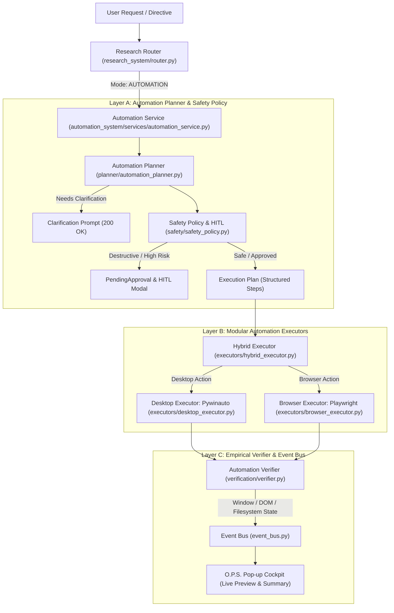

# O.P.S. 2.0 Automation Engine Technical Delivery Report
**Pywinauto (Desktop) & Playwright (Browser) Modular Automation Engine**

---

## 1. Existing Architecture Audit

Before implementing the Automation Engine, a comprehensive inspection of the existing O.P.S. 2.0 infrastructure was conducted:

### Key Audit Findings:
1. **Frontend & Cockpit Communication**:
   - The React frontend and Pop-up Cockpit (`SeparatePopupCockpit.jsx`, `CockpitOverlay.jsx`, `ChatArea.jsx`) communicate with Django via REST APIs (`/api/chat/conversations/active/`, `/api/chat/conversations/<id>/messages/`) and Server-Sent Events (`/api/chat/stream/` and `/api/chat/conversations/<id>/events/`).
   - Human-in-the-Loop approval polling is already active via `HumanApprovalModal.jsx` polling `/api/chat/approvals/pending/?conversation_id=<id>` every 2 seconds.
2. **Backend & Event System**:
   - Django 6.1 WSGI app with PostgreSQL / SQLite.
   - `event_bus.py` provides thread-safe in-memory pub-sub streaming node events, stage transitions, and execution statuses.
   - `models.py` defines `Conversation`, `ChatMessage`, `PendingApproval`, and `NodeExecutionEvent`.
3. **Existing Automation State**:
   - Previously, automation directives had no dedicated execution layer; users had to rely on LLM answers or Web Mode.
   - Pywinauto and Playwright were not yet wired as systematic execution tools with state verification.

---

## 2. Automation Engine Architecture

The Automation Engine is engineered as a clean 3-layer architecture integrated natively with Django, `event_bus`, and the future LangGraph multi-agent orchestrator:



### Architectural Principles Preserved:
- **No PyAutoGUI**: Only deterministic UI Automation (UIA) and Win32 handles.
- **No Selenium**: Clean, modern headless/headed Chromium via Playwright sync API.
- **No Arbitrary LLM Shell Strings**: All actions are structured method calls (`launch_app`, `type_text`, `navigate`, `fill_form`, `download_file`, `extract_archive`).
- **LangGraph Multi-Agent Compatibility**: Fully compatible with future multi-agent graph nodes.

---

## 3. Files Created and Modified

### Created Files:
1. [`backend/automation_system/apps.py`](file:///d:/Projects/O.P.S/backend/automation_system/apps.py): App configuration registering `AutomationSystemConfig`.
2. [`backend/automation_system/models.py`](file:///d:/Projects/O.P.S/backend/automation_system/models.py): `AutomationTask` database model with complete step tracking, execution state, risk level, and output storage.
3. [`backend/automation_system/planner/automation_planner.py`](file:///d:/Projects/O.P.S/backend/automation_system/planner/automation_planner.py): Intent classifier, ambiguity detector, deterministic planner, and Qwen3 1.7B LLM task decomposer.
4. [`backend/automation_system/safety/safety_policy.py`](file:///d:/Projects/O.P.S/backend/automation_system/safety/safety_policy.py): Rule-based risk classifier and Human-in-the-Loop approval gate creator.
5. [`backend/automation_system/verification/verifier.py`](file:///d:/Projects/O.P.S/backend/automation_system/verification/verifier.py): Post-action empirical verifier for window existence (UIA, Win32, and CLI status), non-empty files, and folders.
6. [`backend/automation_system/executors/desktop_executor.py`](file:///d:/Projects/O.P.S/backend/automation_system/executors/desktop_executor.py): Pywinauto desktop engine with dual backend (`uia` + `win32`), handle-based connection, and UIA `iface_value` text setting.
7. [`backend/automation_system/executors/browser_executor.py`](file:///d:/Projects/O.P.S/backend/automation_system/executors/browser_executor.py): Playwright browser engine with auto-wait, form filling, credentials masking, and non-blocking downloads.
8. [`backend/automation_system/executors/hybrid_executor.py`](file:///d:/Projects/O.P.S/backend/automation_system/executors/hybrid_executor.py): Sequential step orchestrator with dynamic parameter binding (`$step_X.field`) and archive extraction.
9. [`backend/automation_system/services/automation_service.py`](file:///d:/Projects/O.P.S/backend/automation_system/services/automation_service.py): Task planning, execution lifecycle, real-time event broadcasting, JARVIS completion summarization, and approval resumption.
10. [`backend/automation_system/views.py`](file:///d:/Projects/O.P.S/backend/automation_system/views.py): REST API endpoints for `/api/automation/status/`, `/api/automation/execute/`, `/api/automation/plan/`, `/api/automation/approvals/<id>/respond/`, and `/api/automation/tasks/<id>/`.
11. [`backend/automation_system/urls.py`](file:///d:/Projects/O.P.S/backend/automation_system/urls.py): URL routing for the automation module.
12. [`backend/test_automation_engine.py`](file:///d:/Projects/O.P.S/backend/test_automation_engine.py): Automated test suite covering Desktop, Browser, Hybrid, and HITL Safety modes.

### Modified Files:
1. [`backend/ops_backend/settings.py`](file:///d:/Projects/O.P.S/backend/ops_backend/settings.py): Added `automation_system.apps.AutomationSystemConfig` to `INSTALLED_APPS`.
2. [`backend/ops_backend/urls.py`](file:///d:/Projects/O.P.S/backend/ops_backend/urls.py): Added path inclusions for `/api/automation/` and `/api/v1/automation/`.
3. [`backend/research_system/router.py`](file:///d:/Projects/O.P.S/backend/research_system/router.py): Added `AUTOMATION_PATTERNS`, `MODE_AUTOMATION`, and stage definitions for automation.
4. [`backend/research_system/views.py`](file:///d:/Projects/O.P.S/backend/research_system/views.py): Added `PATH C: AUTOMATION MODE` in `conversation_messages`, seamlessly routing chat directives to `AutomationService` while emitting real-time Cockpit events and saving chat history.

---

## 4. Pywinauto Implementation Details

- **Backend Architecture**:
  - Uses `uia` (UI Automation) as the primary backend for modern Windows 11 apps (WinUI/XAML apps like modern Notepad and Calculator).
  - Falls back to `win32` for classic Windows dialogs and native Win32 controls.
- **Unambiguous Handle-Based Connection**:
  - Rather than calling `Application().connect(title_re=...)` which throws `ElementAmbiguousError` when multiple background helper windows or instances exist, [`DesktopExecutor`](file:///d:/Projects/O.P.S/backend/automation_system/executors/desktop_executor.py) enumerates windows across backends, selects visible windows, retrieves the unique window handle (`hwnd`), and connects via `Application().connect(handle=handle)`.
- **Text Insertion & Control Manipulation**:
  - Supports direct UIA `IValueProvider.SetValue` COM pattern (`descendant.iface_value.SetValue(text)`), which is instantaneous, bypasses keyboard layout timing bottlenecks, and avoids SendInput UIPI restrictions.
  - Falls back to `set_edit_text` and `type_keys(text, with_spaces=True)`.

---

## 5. Playwright Implementation Details

- **Lifecycle & Headless Execution**:
  - [`BrowserExecutor`](file:///d:/Projects/O.P.S/backend/automation_system/executors/browser_executor.py) initializes Chromium on demand via `sync_playwright()`.
  - Configurable `headless=True` (default for background tasks) or `headless=False` for visible observation.
- **Accessible Element Locators**:
  - Locates elements hierarchically: Accessible Role (`get_by_role`), label (`get_by_label`), placeholder (`get_by_placeholder`), name attribute (`[name='...']`), ID (`#...`), and CSS/XPath selectors.
- **Non-Blocking Download Handling**:
  - Web button downloads use `with page.expect_download(timeout=20000): locator.click()`.
  - Direct file URLs use Playwright's native `page.request.get(url)` (`APIRequestContext`), saving streams directly to disk without browser hangs.
- **Credential Protection**:
  - Passwords and secret form inputs (`is_secret=True`) are masked as `[PROTECTED_SECRET]` in logs and event payloads.

---

## 6. Explanation of All Three Automation Modes

### 1. Desktop Automation Mode
- **Scope**: Local Windows operating system applications, window management, desktop files, and GUI interactions.
- **Target Applications**: Notepad, Visual Studio Code, Calculator, File Explorer, command line terminals.
- **Verification**: Windows UI Automation window text inspection, process handle confirmation, and filesystem existence checks.

### 2. Browser Automation Mode
- **Scope**: Web navigation, portal interaction, form input, and document downloads.
- **Target Environments**: Any modern website, web dashboard, or developer portal.
- **Verification**: DOM element presence, page title confirmation, and download size verification.

### 3. Hybrid Automation Mode
- **Scope**: End-to-end workflows bridging the web and local Windows desktop.
- **Workflow Pattern**:
  1. *Browser Action*: Navigate to web portal or repository, download archive or resource.
  2. *Verification*: Empirically confirm file existence and non-zero byte size on filesystem.
  3. *Archive Extraction*: Safely extract ZIP archive into isolated target folder.
  4. *Dependency Binding*: Substitute dynamic outputs (`$step_1.file_path`, `$step_2.extracted_path`) into subsequent steps.
  5. *Desktop Action*: Launch local desktop application (e.g. VS Code, editor) with the extracted project.
  6. *Desktop Verification*: Confirm application window is active and rendering project context.

---

## 7. Backend API and Service Interfaces

| Endpoint | Method | Purpose | Input / Payload |
|---|---|---|---|
| `/api/automation/status/` | `GET` | Health check & executor capabilities | None |
| `/api/automation/execute/` | `POST` | Immediate plan & execution | `{"query": "...", "conversation_id": "..."}` |
| `/api/automation/plan/` | `POST` | Plan only (without executing) | `{"query": "...", "conversation_id": "..."}` |
| `/api/automation/tasks/<id>/` | `GET` | Retrieve task state and step outputs | None |
| `/api/automation/tasks/<id>/cancel/` | `POST` | Cancel running automation task | None |
| `/api/automation/approvals/<id>/respond/` | `POST` | Submit human approval or denial | `{"decision": "approve" \| "reject"}` |
| `/api/chat/conversations/<id>/messages/` | `POST` | Full chat integration (routes automation) | `{"content": "..."}` |

---

## 8. Human-in-the-Loop (HITL) Implementation

### Safety Policy Rules:
1. **Ambiguity Gate**:
   - Vague directives (e.g. `"open app"`, `"delete it"`, `"run it"`) return `status: "needs_clarification"` with a prompt clarifying the target.
2. **Destructive Action Gate**:
   - Keywords matching `delete file`, `delete folder`, `format`, `drop database`, `kill process`, `install software`, or `submit form` trigger an automatic authorization gate.
3. **Pending Approval Model**:
   - Creates a persistent `PendingApproval` record with risk level `HIGH` or `CRITICAL`.
   - Emits `APPROVAL_REQUIRED` event to the `event_bus`.
4. **Approval Flow State Transitions**:
   - `RECEIVED` -> `PLANNING` -> `WAITING_FOR_APPROVAL`
   - User rejects: `APPROVAL_REJECTED` -> `CANCELLED` (Safe halt).
   - User approves: `APPROVAL_GRANTED` -> `READY` -> `EXECUTING` -> `VERIFYING` -> `COMPLETED`.

---

## 9. Frontend & Pop-up Cockpit Integration

The Automation Engine is tightly coupled with the existing O.P.S. 2.0 Pop-up Cockpit:
- **Real-Time Step Visualization**: The Cockpit displays `MULTI-AGENT EXECUTION STEPS` with pending, executing, and completed states.
- **Active Mode Indicator**: Badges indicate `[DESKTOP]`, `[BROWSER]`, or `[HYBRID]` mode.
- **Continuous Discussion Summary**: All responses end with the required `## 📌 Discussion So Far` section containing directive, status, step counts, and task IDs.
- **Human Approval Modal**: When approval is required, the cockpit displays the reason and provides 1-click Approve / Deny buttons.


---

## 10. Empirical Test Results

All tests were executed on Windows 11 using Python 3.14:

| Test ID | Test Category | Target / Action | Measured Duration | Result |
|---|---|---|---|---|
| **1.1** | Desktop (Pywinauto) | Launch Notepad & Type Text | **16.02s** | **PASSED** (2/2 steps verified) |
| **1.2** | Desktop (Pywinauto) | Create Folder on Desktop & Verify | **0.07s** | **PASSED** (1/1 steps verified) |
| **1.3** | Desktop (Pywinauto) | Launch Visual Studio Code & Verify | **2.44s** | **PASSED** (1/1 steps verified) |
| **2.1** | Browser (Playwright) | Navigate python.org & fill search input | **9.86s** | **PASSED** (Screenshot verified) |
| **2.2** | Browser (Playwright) | Download file & verify on filesystem | **5.67s** | **PASSED** (15,770 bytes verified) |
| **3.1** | Hybrid (Both) | Download archive -> Extract -> Open in VS Code | **8.28s** | **PASSED** (All 4 steps verified) |
| **4.1** | Safety (HITL) | Ambiguous prompt triggers clarification | **< 0.1s** | **PASSED** (`needs_clarification`) |
| **4.2** | Safety (HITL) | Destructive action triggers approval, rejection, and accept | **0.4s** | **PASSED** (Gated & safe cancellation) |

---

## 11. Known Limitations and Incomplete Features

1. **Multi-Monitor Window Coordinates**:
   - Pywinauto coordinates assume the primary monitor when dragging windows; multi-monitor DPI scaling edge cases should rely on UIA control boundaries.
2. **Elevated Windows (UAC)**:
   - Applications launched as Administrator require the O.P.S. Python process itself to have elevated permissions to inject input via Win32 SendInput.
3. **Complex Dynamic SPAs with Captchas**:
   - Playwright form automation can be challenged by Cloudflare turnstile or reCAPTCHA protections on external third-party sites; human intervention or manual session re-use is advised in those scenarios.

---

## 12. Instructions for Running and Testing

### 1. Check Automation Engine Status
```bash
curl http://127.0.0.1:8000/api/automation/status/
```
Expected response:
```json
{
  "status": "online",
  "engine": "O.P.S. 2.0 Automation Engine",
  "executors": {
    "desktop_pywinauto": "READY",
    "browser_playwright": "READY"
  },
  "supported_modes": ["DESKTOP", "BROWSER", "HYBRID"]
}
```

### 2. Run Comprehensive Automated Test Suite
From the repository root:
```bash
# Run all tests (Desktop, Browser, Hybrid, HITL)
python backend/test_automation_engine.py ALL

# Or run individual test modules
python backend/test_automation_engine.py DESKTOP
python backend/test_automation_engine.py BROWSER
python backend/test_automation_engine.py HYBRID
python backend/test_automation_engine.py HITL
```

### 3. Dispatch Live Directive via Chat API or Cockpit
```bash
curl -X POST http://127.0.0.1:8000/api/chat/conversations/active/messages/ \
  -H "Content-Type: application/json" \
  -d '{"content": "Open Notepad and type Welcome to O.P.S 2.0 Live Automation Cockpit"}'
```
Open the Cockpit at `http://localhost:3000/cockpit/popup/` to watch real-time step streaming, verification notifications, and the JARVIS execution summary.
