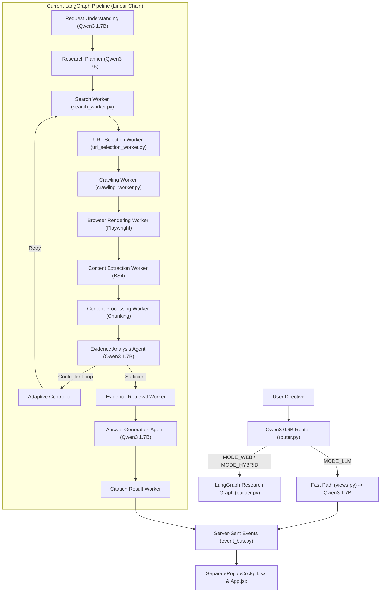

# O.P.S. 2.0 — Web Research Pipeline & Hybrid Mode Audit Report

**Date**: November 3, 2026  
**System**: O.P.S. 2.0 (LangGraph, Ollama Qwen3 0.6B / 1.7B, PySide6 Cockpit)  
**Objective**: Comprehensive audit of Web Research accuracy, scraping latency, evidence validation, and Hybrid Mode implementation.

---

## 1. Existing Architecture & Request Flow

The current request and execution lifecycle traces as follows:

---

## 2. Actual Problems Identified & Evidence

### A. Severe Search Failure: Bot-Blocking on Bing Returning Irrelevant Feeds
- **Symptom**: Asking *"What is the latest stable Python release?"* produced answers with completely unrelated topics or hallucinated version numbers.
- **Direct Code Evidence**: In `search_worker.py`, `_execute_fallback_search()` queried `https://www.bing.com/search`. When called via `httpx`, Bing detected automated scrapers and redirected to regional homepage feeds (returning *Navratri and Panchang calendar* links).
- **Impact**: The crawling worker scraped calendar pages, and Qwen3 1.7B was forced to either summarize Navratri calendars or hallucinate Python release dates from ungrounded parametric memory.

### B. Unpooled, Sequential HTTP Requests Causing High Latency
- **Symptom**: Web and Hybrid mode requests took 15 to 35+ seconds.
- **Direct Code Evidence**:
  - `crawling_worker.py` instantiated a new `httpx.Client()` inside a `for item in selected_urls:` loop for each URL sequentially.
  - `search_worker.py` created separate `httpx.Client()` instances for each search query and each fallback provider sequentially.
  - No connection pooling (`httpx.Limits(max_keepalive_connections=...)`), no concurrent retrieval (`ThreadPoolExecutor`), and no HTTP connection reuse existed.

### C. Zero Caching Across Turns
- **Symptom**: Repeating the same query (or queries seeking the same documentation) repeated all network hops and search calls from scratch.
- **Impact**: Increased latency and redundant network overhead.

### D. Superficial Evidence Validation (No Claim Classification)
- **Symptom**: Hallucinations and unsupported assertions appeared in final responses.
- **Direct Code Evidence**:
  - `evidence_analysis_node` asked the LLM only for a broad `is_sufficient` boolean and `information_gaps` list.
  - Evidence was **never** classified into `VERIFIED`, `PARTIALLY_SUPPORTED`, `CONFLICTING`, or `UNSUPPORTED`.
  - Conflicting sources were not detected or reconciled.
  - `citation_result_worker` unconditionally generated citations `[1], [2]` for all candidate URLs in `retrieved_evidence`, even if the text did not contain the factual claim.

### E. Hybrid Mode is an Unimplemented Illusion
- **Symptom**: Hybrid mode responses were identical to Web mode and failed to provide deep conceptual background knowledge alongside fresh facts.
- **Direct Code Evidence**:
  - In `views.py`, selecting `MODE_HYBRID` merely published a single event (`REASONING_STARTED`) and then called the **exact same linear Web research graph**.
  - No parallel branch existed in `builder.py`. Qwen3 1.7B was never invoked to analyze technical concepts or provide local architectural knowledge.
  - Synthesis received only whatever snippets were scraped from the web.

---

## 3. Root Cause Summary Matrix

| Component | Root Cause | Impact |
|---|---|---|
| `search_worker.py` | Fragile Bing HTML scraping blocked by anti-bot; lack of resilient DuckDuckGo HTML & structured fallback | Returns garbage links (e.g. Panchang calendar) |
| `url_selection_worker.py` | Blind slice `[:4]` without source credibility ranking or domain authority filtering | Scrapes low-quality forum posts over official docs |
| `crawling_worker.py` | Sequential `for` loop creating new `httpx.Client()` per URL without pooling or concurrency | 15–30s latency per research turn |
| `evidence_analysis.py` | No formal claim classification (`VERIFIED`, `PARTIALLY_SUPPORTED`, `CONFLICTING`, `UNSUPPORTED`) | Unsupported claims pass through unchecked |
| `answer_generation.py` | Lax grounding instructions allowing extrapolation when web evidence is sparse | Hallucinated dates, versions, and facts |
| `citation_result_worker.py` | Generates citations for all chunks without verifying if the statement was cited | Fake or mismatched citations |
| `builder.py` / `views.py` | No parallel local reasoning branch in LangGraph for Hybrid Mode | Hybrid mode just duplicates Web mode |

---

## 4. Minimal Targeted Fix Plan

1. **Phase 2 — Resilient Search & Source-Aware Filtering**:
   - Replace fragile Bing scraping with a robust, multi-provider search engine prioritizing **DuckDuckGo HTML Search** (which returns direct, accurate results from `python.org`, `langchain.com`, etc.), Wikipedia Search API, and Brave Search API (when key present).
   - Implement source credibility ranking: prioritize official documentation (`.org`, `.gov`, official vendor domains) and filter low-quality SEO scrapers.
   - Preserve full source metadata: `title`, `url`, `snippet`, `domain`, `retrieval_timestamp`.

2. **Phase 3 — Rigorous Evidence Validation System**:
   - Evaluate extracted evidence against specific query claims.
   - Classify evidence into:
     - `VERIFIED`: Directly stated in retrieved source text.
     - `PARTIALLY_SUPPORTED`: Contextually relevant but incomplete.
     - `CONFLICTING`: Contradictory information between sources (explicitly flagged).
     - `UNSUPPORTED`: No retrieved evidence found (triggers bounded retry or honest disclosure).
   - Add bounded retry logic in the Adaptive Controller when critical evidence is missing.

3. **Phase 4 — Hallucination Elimination & Grounded Citations**:
   - Strict answer-generation prompt instructing Qwen3 1.7B to ground external factual claims exclusively in verified evidence.
   - Ban fabricated URLs, dates, numbers, and unverified assumptions.
   - Enforce verifiable citation tags `[1], [2]` that link strictly to supporting evidence.

4. **Phase 5 — True Hybrid Mode Parallel Architecture**:
   - In `builder.py`, wire a true dual-branch workflow:
     - **Branch A (Local Reasoning)**: Qwen3 1.7B generates conceptual explanation, architecture foundations, and technical reasoning.
     - **Branch B (Web Research)**: Search, concurrent page retrieval, and evidence validation.
     - **Synthesis Node**: Merges both branches. Qwen3 1.7B produces an integrated answer combining architectural depth with fresh, verified facts.

5. **Phase 6 — Scraping Performance & Connection Optimization**:
   - Shared persistent `httpx.Client` with connection pooling (`keepalive_connections=20`).
   - Concurrent retrieval of selected URLs via `concurrent.futures.ThreadPoolExecutor(max_workers=4)`.
   - In-memory LRU TTL cache for search queries and page contents to make repeat lookups instantaneous.
   - Reduced content payloads: clean HTML directly with BS4, stripping boilerplate and ads.
   - Restrict Playwright strictly to JS-heavy domains (`twitter.com`, `medium.com`, etc.).

6. **Phase 7 & 8 — Router & Cockpit Stage Synchronization**:
   - Synchronize all real backend events with Cockpit mode indicators `[ LLM ] [ WEB ] [ HYBRID ]` and processing stages checklist.
