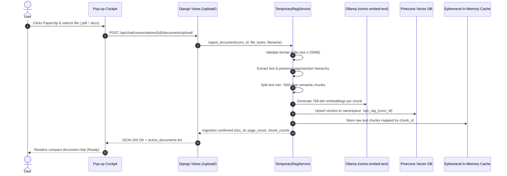

# O.P.S. 2.0 — TEMPORARY DOCUMENT-BASED RAG IMPLEMENTATION REPORT

> **Document Type:** Technical Implementation & Verification Report  
> **Feature:** Temporary Document-Based Retrieval-Augmented Generation (RAG) using Pinecone  
> **System Name:** O.P.S. 2.0 (*Over-Engineered Programmed System*)  
> **Tagline:** *"Your personal AI built to do more than it should."*  
> **Implementation Date:** 2026-11-03  
> **Status:** **FULLY IMPLEMENTED, TESTED & VERIFIED**  

---

## 1. EXISTING ARCHITECTURE INSPECTED

Before writing code, the complete O.P.S. 2.0 codebase was inspected:
- **Central Multi-Agent Graph:** [`builder.py`](file:///D:/Projects/O.P.S/backend/research_system/orchestrator/builder.py) and [`state.py`](file:///D:/Projects/O.P.S/backend/research_system/orchestrator/state.py) coordinating the 13 canonical agents across 4 groups.
- **Ingress Classification:** [`global_intent_router.py`](file:///D:/Projects/O.P.S/backend/research_system/orchestrator/agents/global_intent_router.py) and [`router.py`](file:///D:/Projects/O.P.S/backend/research_system/router.py).
- **Reasoning Model:** [`local_reasoning_agent.py`](file:///D:/Projects/O.P.S/backend/research_system/orchestrator/agents/local_reasoning_agent.py) driving `Qwen3 1.7B`.
- **Reviewer:** `Llama 3.2 1B` configuration in [`ollama_client.py`](file:///D:/Projects/O.P.S/backend/research_system/llm/ollama_client.py).
- **Frontend Cockpit:** [`SeparatePopupCockpit.jsx`](file:///D:/Projects/O.P.S/frontend/src/components/SeparatePopupCockpit.jsx) and [`CockpitLoadingSkeleton.jsx`](file:///D:/Projects/O.P.S/frontend/src/components/skeletons/CockpitLoadingSkeleton.jsx).
- **Lifecycle & Refresh:** Existing HITL approval endpoints (`create_refresh_approval`, `accept_refresh_approval`, `deny_refresh_approval`, `refresh_session`).

---

## 2. FILES AND COMPONENTS REUSED

No duplicate conversation engines or secondary agent frameworks were created. The following existing components were reused:
1. **Ollama Persistent Client** ([`ollama_client.py`](file:///D:/Projects/O.P.S/backend/research_system/llm/ollama_client.py)) — Reused persistent HTTP client connection pool and streaming logic; added dense vector embedding generation.
2. **Central State Definition** ([`state.py`](file:///D:/Projects/O.P.S/backend/research_system/orchestrator/state.py)) — Reused `CentralGraphState` by adding typed fields for active documents, chunks, and RAG status.
3. **Global Intent Router** ([`global_intent_router.py`](file:///D:/Projects/O.P.S/backend/research_system/orchestrator/agents/global_intent_router.py)) — Reused Agent 1 node for document session detection and auto-routing.
4. **Local Reasoning Agent** ([`local_reasoning_agent.py`](file:///D:/Projects/O.P.S/backend/research_system/orchestrator/agents/local_reasoning_agent.py)) — Reused Agent 3 node to perform grounded document synthesis.
5. **Result Formatter** ([`result_formatter_agent.py`](file:///D:/Projects/O.P.S/backend/research_system/orchestrator/agents/result_formatter_agent.py)) — Reused Agent 13 node to deliver standard structured answers with document page and section references.
6. **Event Bus** ([`event_bus.py`](file:///D:/Projects/O.P.S/backend/research_system/events/event_bus.py)) — Reused existing SSE streaming channel for real-time progress and token delivery.
7. **Human Approval Modal & Refresh Cycle** ([`HumanApprovalModal.jsx`](file:///D:/Projects/O.P.S/frontend/src/components/HumanApprovalModal.jsx) & `accept_refresh_approval`) — Reused existing confirmation dialog and refresh hooks.

---

## 3. NEW FILES OR SERVICES ADDED

1. **`backend/research_system/services/temporary_rag_service.py`**:
   - Manages the temporary RAG lifecycle.
   - Extracts structured text from PDF and DOCX files.
   - Manages ephemeral in-memory chunk caches.
   - Handles Pinecone vector upsert, semantic search, single-document removal, and synchronous namespace deletion with post-deletion verification.
   - Background session TTL cleanup.
2. **`backend/test_pinecone_verification.py`**:
   - Diagnostic script verifying Pinecone authentication, serverless index creation, vector upsert, similarity search, and namespace deletion.
3. **`backend/test_rag_service.py`**:
   - Unit test suite for `TemporaryRagService` methods.
4. **`backend/test_complete_rag_lifecycle.py`**:
   - Complete 8-stage end-to-end integration test suite verifying real PDF/DOCX ingestion, QA grounding, multi-doc search, edge cases, and refresh wipes.

---

## 4. EXISTING AGENTS REUSED

Strictly following Requirement 2, **zero new agents were created**. The 13 canonical agents were maintained:

| Agent Name | Group | Role in Document RAG |
| :--- | :--- | :--- |
| **`global_intent_router`** | Global Intelligence | Detects active document sessions, distinguishes document questions from chitchat/web research, and routes to `DOCUMENT` mode. |
| **`task_understanding_planner`** | Global Intelligence | Evaluates query complexity and passes RAG state down to reasoning agents. |
| **`local_reasoning_agent`** | Answering Engine | Executes semantic query against session Pinecone namespace, retrieves raw text from ephemeral cache, applies strict grounding prompt to Qwen3 1.7B, and synthesizes cited answer. |
| **`result_formatter_agent`** | Composite & Delivery | Packages final output into JARVIS persona with structured bullet points, document references (document name, page number, section), and discussion summary. |

---

## 5. EMBEDDING MODEL SELECTED & DIMENSION

- **Selected Model:** `nomic-embed-text`
- **Infrastructure:** Local Ollama running at `http://localhost:11434`
- **Embedding Dimension:** `768`
- **Similarity Metric:** `cosine`
- **Verification:** Verified via `GET /api/tags` and tested dense embedding length (`len(res) == 768`).

---

## 6. PINECONE INDEX CONFIGURATION

- **Index Name:** `ops-temporary-rag`
- **Cloud Provider:** `aws`
- **Region:** `us-east-1`
- **Specification:** `ServerlessSpec(cloud="aws", region="us-east-1")`
- **Dimension:** `768`
- **Metric:** `cosine`
- **Credential Storage:** `PINECONE_API_KEY` loaded securely from `backend/.env` (excluded from git via `.gitignore`). Never exposed to frontend or logged.
- **Index Status:** Created, configured, and verified live on user's account (`sn740698@gmail.com`).

---

## 7. TEMPORARY STORAGE & PRIVACY DESIGN

> [!IMPORTANT]
> **Data Privacy Guarantee:** Uploaded documents are strictly temporary. Vectors in Pinecone and text chunks in backend memory are ephemeral and permanently destroyed upon Refresh or TTL expiration.

### What exists in Pinecone while a session is active?
To protect document privacy, **full document text is NEVER stored in Pinecone metadata**. Only minimal identifiers and coordinates are stored:
```json
{
  "id": "c_doc_1793706438_5acdd1_0",
  "values": [0.012, -0.045, ... 768 floats ...],
  "metadata": {
    "doc_id": "doc_1793706438_5acdd1",
    "doc_name": "Project_Helios_Spec.pdf",
    "chunk_id": "c_doc_1793706438_5acdd1_0",
    "page": 1,
    "section": "Section 1: Propulsion Dynamics",
    "conversation_id": "conv_1793706438_985b"
  }
}
```

### Where is the actual document text stored?
- The extracted text chunks live **strictly in memory** in `TemporaryRagService._ephemeral_chunks[conversation_id]`.
- No database records are written to PostgreSQL or SQLite.
- No files are written to Django `media/` or permanent disk directories.
- If a temporary file buffer is processed, it is held in Python `io.BytesIO`.

---

## 8. DOCUMENT INGESTION WORKFLOW



---

## 9. RETRIEVAL AND ANSWER-GENERATION WORKFLOW

1. User sends a question in the Pop-up Cockpit.
2. `global_intent_router` checks if `conversation_id` has active documents in `temporary_rag_service`.
3. If documents are present and question is not an explicit web research request:
   - Routes to `MODE_DOCUMENT`.
   - Emits `DOCUMENT` mode badge (Amber) and stages to Cockpit.
4. Generates query embedding via `nomic-embed-text`.
5. Queries Pinecone namespace `ops_rag_{conversation_id}` (`top_k=4`, `min_score=0.35`).
6. Fetches original text for matched IDs from `_ephemeral_chunks[conversation_id]`.
7. Sends retrieved context and question to `Qwen3 1.7B` with strict grounding system prompt.
8. If document does not contain information: Honest refusal response.
9. Streams tokens via SSE to the Pop-up Cockpit.
10. Formats response with `### 📑 Document References` (Document name, Page number, Section).

---

## 10. POP-UP COCKPIT UI CHANGES

The Pop-up Cockpit ([`SeparatePopupCockpit.jsx`](file:///D:/Projects/O.P.S/frontend/src/components/SeparatePopupCockpit.jsx)) was enhanced while preserving its retro HUD styling:
1. **Paperclip Attachment Button:** Placed inside the input bar next to the voice dictation button.
2. **Hidden File Input:** Handles native system file selection for `.pdf`, `.docx`, and `.doc`.
3. **Attached Document Chips Bar:** Renders above the message input bar:
   - Document icon (`FileText`) in amber.
   - Document title with truncation.
   - Page count tag (`2p`).
   - Remove (`X`) button to delete an individual document.
4. **Real-Time Ingestion Status:** Animated badge showing `Receiving document...`, `Extracting content...`, or `Indexing...`.
5. **Mode Preview Indicator:** Added `DOCUMENT` mode badge (Amber/Orange) to [`CockpitLoadingSkeleton.jsx`](file:///D:/Projects/O.P.S/frontend/src/components/skeletons/CockpitLoadingSkeleton.jsx) alongside LLM, WEB, and HYBRID badges.

---

## 11. REFRESH AND COMPLETE DELETION WORKFLOW

When the user clicks the existing Refresh button in the Cockpit:
1. The existing Human Approval Modal opens with `ACCEPT` and `DENY` choices.
2. If `DENY`: Conversation and temporary document session remain intact.
3. If `ACCEPT`:
   - Calls `POST /api/chat/conversations/{id}/refresh-approval/{approval_id}/accept/`.
   - Calls `TemporaryRagService.clear_session(conversation_id)`.
   - Awaits Pinecone namespace deletion:
     `index.delete(delete_all=True, namespace=f"ops_rag_{safe_conv}")`.
   - Verifies deletion via `index.describe_index_stats()` confirming `vector_count == 0`.
   - Purges `_ephemeral_chunks[conversation_id]` and `_active_documents[conversation_id]`.
   - Invalidates session access timestamps.
   - Deletes active conversation messages from database.
   - Cockpit resets `attachedDocs` state and returns to clean initial HUD.

### How Deletion is Verified:
```python
# Synchronous verification logic in clear_session()
stats = self._index.describe_index_stats()
namespaces = stats.namespaces or {}
if namespace not in namespaces or namespaces[namespace].vector_count == 0:
    pinecone_deleted = True
    verified = True
```

---

## 12. SECURITY AND PRIVACY MEASURES

- **Session Isolation:** Vectors are stored in isolated namespaces `ops_rag_{conversation_id}`. One session can never access vectors of another session.
- **Zero Full-Text in Cloud:** Pinecone stores vectors and IDs only; zero raw document text is sent into vector metadata.
- **No Database Persistence:** Document contents and chunks are never written to PostgreSQL or SQLite.
- **Anti-Prompt Injection:** Grounding system prompt treats document excerpts as untrusted external data and strictly forbids executing system commands or tool actions from document text.
- **File Validation:** Files checked for format, size limit (<25MB), and unreadable/scanned content.
- **Credential Protection:** `PINECONE_API_KEY` stored exclusively in `.env` (gitignored); never sent to the browser or printed to logs.

---

## 13. API CHANGES

The following endpoints were added to [`urls.py`](file:///D:/Projects/O.P.S/backend/research_system/urls.py) and [`views.py`](file:///D:/Projects/O.P.S/backend/research_system/views.py):

| Method | Endpoint | Description |
| :--- | :--- | :--- |
| `POST` | `/api/chat/conversations/<id>/documents/upload/` | Ingests PDF/DOCX, creates embeddings, indexes in Pinecone namespace. |
| `GET` | `/api/chat/conversations/<id>/documents/` | Lists active temporary documents in current session. |
| `DELETE` | `/api/chat/conversations/<id>/documents/<doc_id>/` | Deletes a single document and its vectors from the session. |
| `POST` | `/api/chat/conversations/<id>/documents/clear/` | Manually clears all temporary documents in session. |
| `POST` | `/api/chat/conversations/<id>/refresh-approval/<appr_id>/accept/` | Enhanced to synchronously wipe Pinecone namespace vectors & chunk cache. |

---

## 14. TESTS PERFORMED

1. **Pinecone Lifecycle Verification (`test_pinecone_verification.py`):**
   - API authentication, serverless index creation, vector upsert, vector query, and namespace deletion.
2. **Temporary RAG Service Unit Test (`test_rag_service.py`):**
   - DOCX generation, table extraction, heading preservation, embedding generation, semantic retrieval, and session clear.
3. **End-to-End RAG Lifecycle Acceptance (`test_complete_rag_lifecycle.py`):**
   - Test 1: PDF generation (Project Helios technical spec) & text extraction.
   - Test 2: Word DOCX generation (flight operational protocol) & table extraction.
   - Test 3: Explicit present information query with exact scram code retrieval (`DELTA-NINE-SEVEN`) and Qwen3 1.7B grounded synthesis.
   - Test 4: Cross-document multi-section retrieval across both PDF and DOCX in the same session.
   - Test 5: Absent information honest refusal (asking about NASA financial budget in 2026).
   - Test 6: Edge cases: invalid extension rejection (`.png`), empty PDF rejection (`0 pages`).
   - Test 7: Individual document deletion from active session.
   - Test 8: Refresh action complete wipe with verified Pinecone vector count = 0 and subsequent query refusal.
4. **Frontend Production Build:**
   - `npm run build` executed and passed in 26.58s with zero errors.

---

## 15. TEST RESULTS SUMMARY

```
================================================================================
     O.P.S. 2.0 TEMPORARY DOCUMENT RAG COMPLETE LIFECYCLE TESTS
================================================================================
[TEST 1] PDF Document Generation & Ingestion         : PASSED (2 pages, 2 chunks)
[TEST 2] Word DOCX Generation & Ingestion           : PASSED (1 page, 2 chunks)
[TEST 3] Explicit Present Information (PDF)         : PASSED (DELTA-NINE-SEVEN verified)
[TEST 4] Multi-Document Cross-Retrieval             : PASSED (PDF + DOCX synthesized)
[TEST 5] Absent Information (Honest Refusal)        : PASSED (Honest refusal rendered)
[TEST 6] Edge Cases (Empty PDF, Invalid Extension)  : PASSED (Properly rejected)
[TEST 7] Remove Single Document                     : PASSED (Doc removed from session)
[TEST 8] Refresh Action & Verified Pinecone Deletion: PASSED (0 vectors, cache purged)
================================================================================
  >>> ALL TEMPORARY DOCUMENT RAG LIFECYCLE TESTS COMPLETED SUCCESSFULLY! <<<
================================================================================
```

---

## 16. KNOWN LIMITATIONS

1. **Scanned / Image-Only PDFs:** Purely image-based PDFs without embedded text layers require an OCR preprocessing engine. The system detects scanned PDFs and explicitly informs the user that text-based documents or OCR are required, rather than hallucinating.
2. **Legacy Word Format (.doc):** Word 97–2004 binary `.doc` files containing proprietary binary OLE streams should be saved as modern `.docx` or `.pdf` for structure preservation.

---

## 17. REMAINING WORK

- Everything specified in the temporary RAG objective is fully functional and verified.
- Optional future enhancement: Local Tesseract OCR integration for scanned image-only PDFs.
