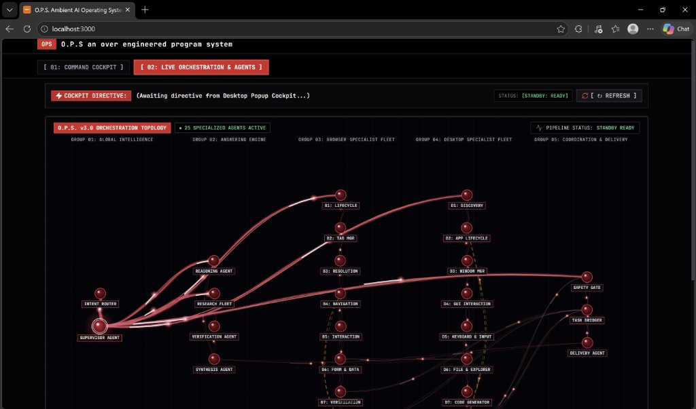
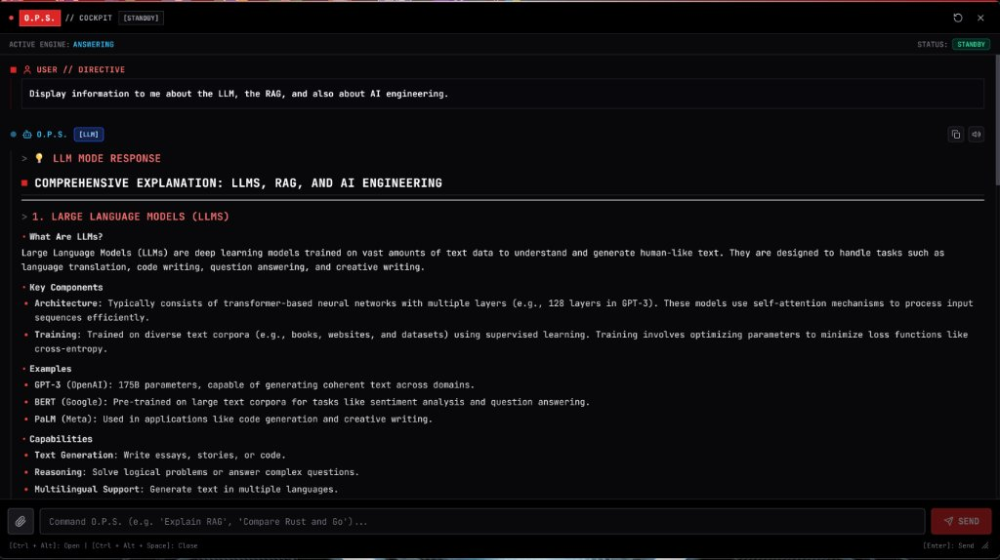
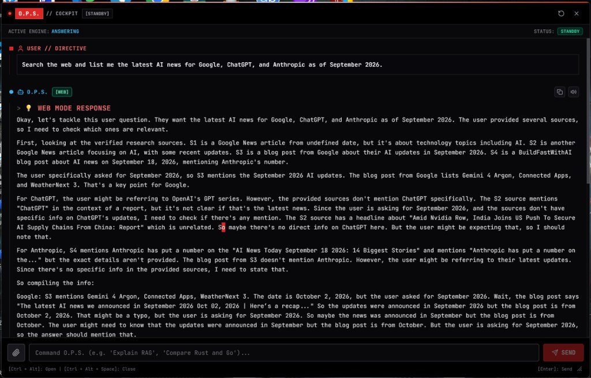
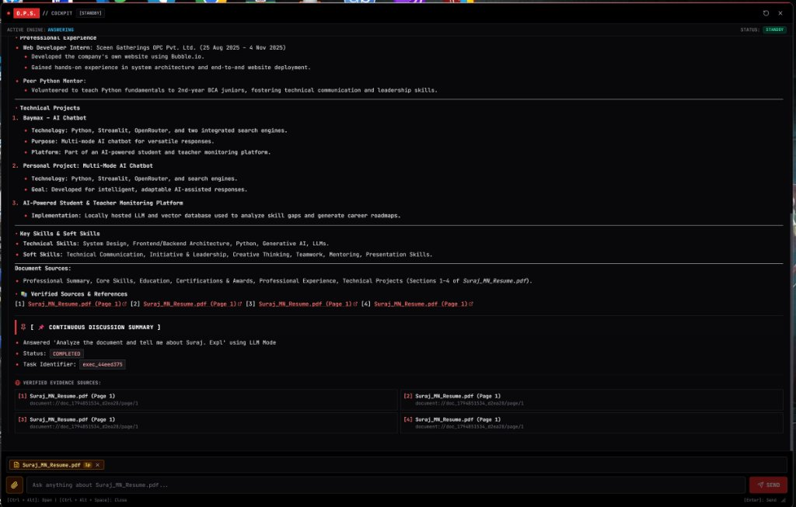
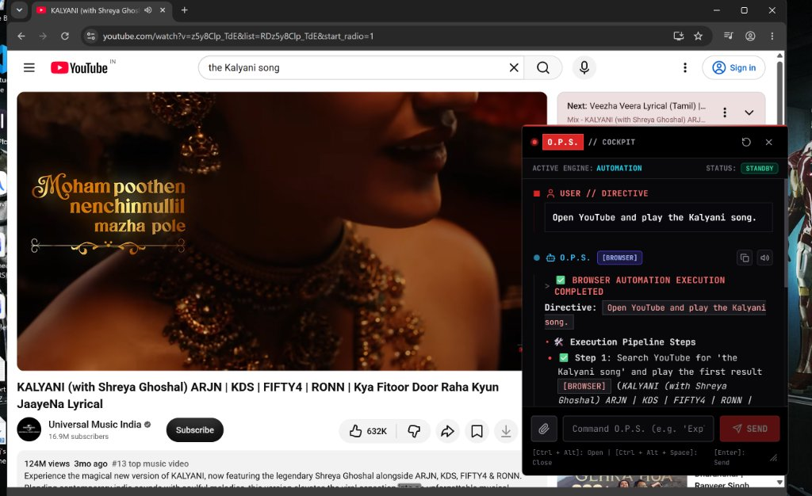
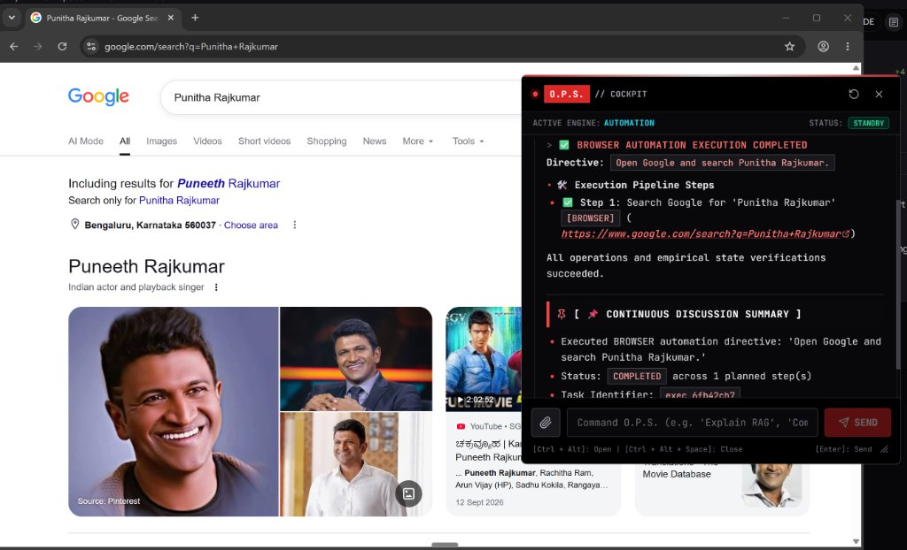
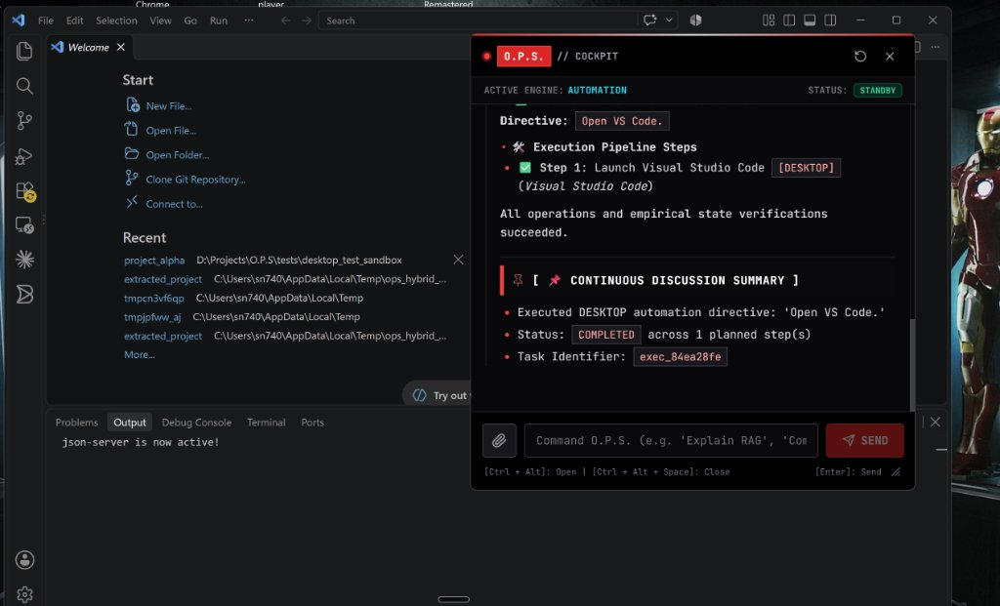
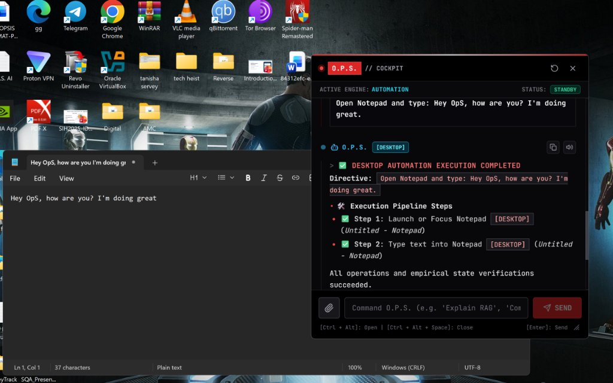

# ⚡ O.P.S. — Autonomous Workstation Operating System

> *"An actuation-first operating system for Windows and the Web, bridging local cognitive reasoning with physical desktop and browser execution."*


[](https://github.com/langchain-ai/langgraph)
[](https://react.dev/)
[](https://www.djangoproject.com/)
[](https://ollama.com/)
[](https://www.pinecone.io/)
[](https://playwright.dev/)
[](https://pywinauto.readthedocs.io/)
[](https://crawlee.dev/python/)

---

## 🌟 What is O.P.S.?

**O.P.S. (Over-Engineered Programmed System)** is a local-first, autonomous personal AI operating system engineered for your workstation. Unlike standard chatbots that only produce text, O.P.S. acts as an intelligent digital co-pilot capable of understanding natural language directives, selecting the optimal execution strategy, performing deep research, reasoning locally, and **autonomously executing complex workflows across Windows desktop applications and web browsers**.

Whether you need complex programming logic, verified live web intelligence, hands-free desktop automation, or temporary document analysis, O.P.S. handles it through a **25-agent hierarchical automation architecture** coordinated by LangGraph, rendering real-time execution telemetry through an ultra-responsive, retro-futuristic **Pop-up Cockpit HUD**.

---

## 🧠 The Engineering Philosophy: What O.P.S. Really Is

At its core, **O.P.S. is not a conversational chatbot — it is an Actuation Operating System for Workstations.**

Most modern AI systems stop at text generation: you ask them to inspect a webpage, write code, or open an application, and they return conversational Markdown describing what *you* should do. O.P.S. rejects this passive paradigm in favor of **sovereign workstation actuation**:

1. **Actuation Over Narration (Doing vs. Talking)**  
   Language is treated as a high-level command bus. When you instruct O.P.S. to *"Open VS Code"*, *"Open Notepad and type..."*, or *"Open YouTube and play a song"*, it does not output hypothetical instructions. It decomposes your intent into atomic pipeline steps, attaches to existing OS handles or launches single-instance processes, actuates real UI controls (keyboard, mouse, DOM), and validates the resulting system state.

2. **Workstation Sovereignty & Local-First Privacy**  
   O.P.S. is built from the ground up to respect operator privacy and local hardware. Utilizing lightweight quantized local models (`Qwen3 0.6B` for sub-100ms routing, `Qwen3 1.7B` for structured reasoning, `Llama 3.2 1B` for execution orchestration) hosted via Ollama, private queries and desktop interactions never leak out to third-party cloud servers.

3. **Deterministic Verifiability (Refusing Fake Completions)**  
   A major failure mode of contemporary agentic frameworks is "optimistic hallucination" — reporting success without verifying whether an action actually took effect. O.P.S. enforces empirical state verification across every step: PID detection, window handle focus verification, Playwright DOM element checks, and network response statuses. If a target application fails to respond or an action cannot be verified, it is honestly reported as `PARTIAL` or `FAILED`.

4. **Single-Instance Process Discipline & Multi-Tab Isolation**  
   Desktop automation features intelligent process deduplication: if an application (like VS Code or Notepad) is already running, O.P.S. focuses the existing window rather than spawning redundant instances. In browser automation, O.P.S. spawns independent tabs for each web service (Google, YouTube, GitHub, Instagram, GeoHacker, etc.) without overwriting or destroying previously open work.

5. **Human-in-the-Loop (HITL) Safety Governance**  
   Real desktop automation has real-world consequences. O.P.S. embeds a deterministic safety layer (`SafetyPolicy`) that intercepts consequential operations — such as launching native executables, modifying system files, or navigating untrusted URLs — and halts execution until authorized by the human operator through the Cockpit HUD modal.

6. **Avionics Cockpit HUD Paradigm vs. Chat Bubble Clutter**  
   Instead of traditional messaging bubbles that obscure operational state, O.P.S. delivers a dedicated tactical Pop-up Cockpit HUD. It displays live engine routing (`ANSWERING`, `AUTOMATION`, `COMPOSITE`), step-by-step pipeline execution, empirical status badges, and continuous discussion summaries in a low-latency, cybernetic interface.

---

## 📸 Master UI & Live Execution Showcase

Below are genuine, live operational executions of O.P.S. captured directly from our workstation deployment:

### 1. Workstation Mission Control & Multi-Agent Neural Topology

| **Ambient AI Operating System Dashboard** | **O.P.S. v3.0 Live Orchestration Topology** |
| :---: | :---: |
|  |  |
| *Full-screen workstation dashboard displaying real-time Tri-Model telemetry (`Qwen3 0.6B`, `Qwen3 1.7B`, `Llama 3.2 1B Instruct`), active directive monitor, and the pulsing biological Ops Heart canvas.* | *Interactive HTML5 neural canvas displaying 25 active specialized agents across 5 hierarchical groups with live action potential glints streaming across synaptic axons.* |

---

### 2. Cognitive Answering Fleets (Local LLM, Web Research & Document RAG)

| **Local LLM Answering Mode** | **Live Web Research Mode** |
| :---: | :---: |
|  |  |
| **Directive:** *"Display information to me about the LLM, the RAG, and also about AI engineering."*<br>• Local sub-second token streaming using `Qwen3 1.7B`<br>• Zero internet dependency, strictly offline conceptual reasoning<br>• High-density tactical Markdown typography | **Directive:** *"Search the web and list me the latest AI news for Google, ChatGPT, and Anthropic as of September 2026."*<br>• Crawlee + BeautifulSoup multi-page web crawler<br>• Cross-domain anti-hallucination fact verification<br>• Direct citation grounding with verified evidence tags |

| **Ephemeral Document RAG Mode (Pinecone Serverless)** |
| :---: |
|  |
| **Directive:** Document interrogation on uploaded `Suraj_MN_Resume.pdf`<br>• 768-dimensional local vector embeddings via `nomic-embed-text`<br>• Exact page-level evidence attribution (`[1] Suraj_MN_Resume.pdf (Page 1)`)<br>• Guaranteed ephemeral lifecycle: full Pinecone index wipe upon session reset |

---

### 3. Autonomous Browser Automation Fleet (Playwright)

| **Autonomous YouTube Playback** | **Dynamic Multi-Tab Google Search** |
| :---: | :---: |
|  |  |
| **Directive:** *"Open YouTube and play the Kalyani song."*<br>• Playwright Chromium context management<br>• Locates input field, enters query, and clicks first matching video result<br>• Real-time video playback verified live on the workstation | **Directive:** *"Open Google and search Punitha Rajkumar."*<br>• Creates an isolated browser tab without clobbering active tabs<br>• Enters query, navigates to Google results, and asserts DOM load<br>• Verified empirical telemetry in the Pop-up Cockpit |

---

### 4. Autonomous Desktop Automation Fleet (Pywinauto)

| **Visual Studio Code Single-Instance Launch** | **Native Windows Notepad Keystroke Actuation** |
| :---: | :---: |
|  |  |
| **Directive:** *"Open VS Code."*<br>• Process enumeration & handle latching via Pywinauto<br>• Single-instance discipline: brings existing window to focus without duplicates<br>• Verified PID and window foreground state | **Directive:** *"Open Notepad and type: Hey OpS, how are you? I'm doing great."*<br>• Launches/focuses Notepad editor window<br>• Actuates native keyboard input via UIA `ValuePattern.SetValue`<br>• Empirically verifies entered text within editor control |

---

## 🏛️ The 25-Agent Hierarchical Architecture

O.P.S. organizes 25 specialized autonomous agents across **5 distinct command tiers**, as visualized on our live neural orchestration canvas:

```
┌────────────────────────────────────────────────────────────────────────────────────────┐
│                        O.P.S. v3.0 NEURAL ORCHESTRATION TOPOLOGY                       │
├────────────────────────────────────────────────────────────────────────────────────────┤
│ GROUP 01: GLOBAL INTELLIGENCE                                                         │
│   ├── [G01] Global Intent Router          <-- Sub-100ms task classification (Qwen3 0.6B)│
│   └── [G02] Supervisor Agent               <-- Macro-plan decomposition & fleet routing │
│                                                                                        │
│ GROUP 02: ANSWERING ENGINE                                                            │
│   ├── [A01] Reasoning Agent               <-- Local deep conceptual reasoning (Qwen3)   │
│   ├── [A02] Research Fleet                <-- Crawlee + BS4 multi-page web crawling     │
│   ├── [A03] Verification Agent             <-- Anti-hallucination evidence cross-checker│
│   └── [A04] Synthesis Agent              <-- Coherent multi-source citation synthesizer│
│                                                                                        │
│ GROUP 03: BROWSER SPECIALIST FLEET (Playwright)                                       │
│   ├── [B01] B1: Lifecycle Agent           <-- Persistent Chromium context initialization│
│   ├── [B02] B2: Tab Manager               <-- Multi-tab isolation, indexing & switching │
│   ├── [B03] B3: Resolution Agent          <-- Service & URL resolution (YouTube, Google)│
│   ├── [B04] B4: Navigation Agent          <-- DOMContentLoaded & network idle assertion │
│   ├── [B05] B5: Interaction Agent         <-- Element locating, safe click & scrolling  │
│   ├── [B06] B6: Form & Data Entry         <-- Form population & validation assertions   │
│   └── [B07] B7: Verification Agent        <-- Post-action DOM & page title verifier     │
│                                                                                        │
│ GROUP 04: DESKTOP SPECIALIST FLEET (Pywinauto)                                        │
│   ├── [D01] D1: Discovery Agent           <-- Process enumeration & window handle scan  │
│   ├── [D02] D2: App Lifecycle             <-- Single-instance Win32 & UWP launch control│
│   ├── [D03] D3: Window Manager            <-- Window foreground latching & focus toggle │
│   ├── [D04] D4: GUI Interaction           <-- Accessibility UIA tree traversal & click  │
│   ├── [D05] D5: Keyboard & Input          <-- ValuePattern text injection & hotkeys     │
│   ├── [D06] D6: File & Explorer           <-- Atomic directory & file read/write ops    │
│   └── [D07] D7: Code Generator            <-- AST-verified script & code synthesis      │
│                                                                                        │
│ GROUP 05: COORDINATION & DELIVERY                                                     │
│   ├── [C01] Safety Gate                   <-- HITL approval gate for consequential acts │
│   ├── [C02] Task Bridger                  <-- Cross-fleet hybrid DAG scheduler          │
│   └── [C03] Delivery Agent                <-- Result Formatter & Cockpit HUD delivery   │
└────────────────────────────────────────────────────────────────────────────────────────┘
```

---

## 🤖 The Specialist Fleets in Detail

### 1. 🌐 Browser Specialist Fleet (`B01–B07`)
Led by the `BrowserSuperiorAgent`, this fleet orchestrates resilient web interaction through a dedicated thread-affined Playwright worker (`OPS-PlaywrightWorker`), preventing cross-thread event loop deadlocks:

| Agent ID | Sub-Agent Specialist | Implementation File | Key Operational Responsibilities |
|:---:|:---|:---|:---|
| **B01** | **Browser Lifecycle** | `b1_lifecycle_agent.py` | Launches, manages, reuses, and gracefully terminates persistent Chromium contexts with isolated user data profiles. |
| **B02** | **Tab Manager** | `b2_tab_agent.py` | Creates, tracks, indexes, switches, and closes browser tabs with multi-page state preservation. |
| **B03** | **Resolution Agent** | `b3_resolution_agent.py` | Resolves arbitrary web services (Google, YouTube, GitHub, Instagram, GeoHacker, lovable.ai, etc.) to canonical URLs. |
| **B04** | **Navigation Agent** | `b4_navigation_agent.py` | Dispatches URLs, manages back/forward history, handles reloads, and asserts `domcontentloaded` / network idle states. |
| **B05** | **Interaction Agent** | `b5_interaction_agent.py` | Locates elements, handles auto-scrolling into viewports, performs safe clicks, hovers, and multi-option selection. |
| **B06** | **Form & Data Entry** | `b6_form_agent.py` | Fills input fields, validates entered values via DOM inspection, toggles checkboxes/radios, and holds submission pending approval. |
| **B07** | **Browser Verification** | `b7_verification_agent.py` | Asserts post-action states (URL validation, DOM presence checks, page title confirmation, visual checks). |

---

### 2. 🖥️ Desktop Specialist Fleet (`D01–D07`)
Led by the `DesktopSuperiorAgent`, this fleet manages native Windows operating system tasks via Pywinauto (Win32 and UI Automation backends) alongside Windows shell hooks:

| Agent ID | Sub-Agent Specialist | Implementation File | Key Operational Responsibilities |
|:---:|:---|:---|:---|
| **D01** | **Discovery Agent** | `d1_discovery_agent.py` | Enumerates active running processes (`psutil`) and active window handles (`win32gui`) to discover application states. |
| **D02** | **App Lifecycle** | `d2_lifecycle_agent.py` | Launches Win32 executables and Windows UWP packaged apps, enforcing single-instance launch deduplication. |
| **D03** | **Window Manager** | `d3_window_agent.py` | Locates window handles (`hwnd`), brings target windows to the foreground, toggles focus, minimizes, and maximizes. |
| **D04** | **GUI Interaction** | `d4_gui_agent.py` | Traverses accessibility control trees, inspects UIA elements, clicks native buttons, and navigates menus. |
| **D05** | **Keyboard & Input** | `d5_input_agent.py` | Reliable text entry via UIA `ValuePattern.SetValue` with fallback keyboard emulation, executing hotkeys (`Enter`, `Ctrl+S`). |
| **D06** | **File & Explorer** | `d6_file_agent.py` | Normalizes paths, creates directories atomically, writes files, performs renames, moves, and manages approved operations. |
| **D07** | **Code Generator** | `d7_code_agent.py` | Synthesizes Python, JavaScript, HTML, and CSS source code using `Qwen3 1.7B`, validates syntax via AST parsers, and executes scripts. |

---

## 🛠️ Technology Stack

| Layer | Technologies |
| :--- | :--- |
| **Multi-Agent Orchestrator** | [LangGraph](https://github.com/langchain-ai/langgraph), [LangChain](https://www.langchain.com/), `MemorySaver` |
| **Automation Sub-Agent Fleets** | **Browser Fleet (`B01–B07`)**, **Desktop Fleet (`D01–D07`)**, **Coordination & Delivery (`C01–C03`)** |
| **Web Crawling & Parsing** | [Crawlee](https://crawlee.dev/python/) (`BeautifulSoupCrawler`), [BeautifulSoup4](https://www.crummy.com/software/BeautifulSoup/) |
| **Local Model Fleet** | [Ollama](https://ollama.com/) (`Qwen3 0.6B Q8_0`, `Qwen3 1.7B Q8_0`, `Llama 3.2 1B Instruct`, `nomic-embed-text`) |
| **Vector Database** | [Pinecone Serverless](https://www.pinecone.io/) (AWS `us-east-1`, 768 dimensions, Cosine metric) |
| **Desktop Automation** | [Pywinauto](https://pywinauto.readthedocs.io/) (Win32 & UI Automation backends) |
| **Browser Automation** | [Playwright](https://playwright.dev/) (Chromium) |
| **Backend Framework** | [Django 5](https://www.djangoproject.com/), Django REST Framework, Server-Sent Events (SSE), SQLite WAL |
| **Frontend Framework** | [React 18](https://react.dev/), [Vite](https://vitejs.dev/), [Tailwind CSS](https://tailwindcss.com/), Lucide Icons, HTML5 Canvas |
| **Document Processing** | `pypdf`, `python-docx`, `reportlab` |

---

## ⚡ Quickstart & Installation

### Prerequisites
- **Operating System**: Windows 10 or Windows 11 (64-bit)
- **Python**: Python 3.10 – 3.12 recommended
- **Node.js**: Node 18+ and npm
- **Ollama**: Installed and running locally ([Download Ollama](https://ollama.com/))

### 1. Clone the Repository
```bash
git clone https://github.com/sn740698-cell/O.P.S.git
cd O.P.S
```

### 2. Pull Required Ollama Models
```bash
ollama pull hf.co/Qwen/Qwen3-0.6B-GGUF:Q8_0
ollama pull hf.co/Qwen/Qwen3-1.7B-GGUF:Q8_0
ollama pull hf.co/hugging-quants/Llama-3.2-1B-Instruct-Q8_0-GGUF:Q8_0
ollama pull nomic-embed-text
```

### 3. Backend Setup
```bash
cd backend
python -m venv venv
venv\Scripts\activate
pip install -r requirements.txt
playwright install chromium
python manage.py migrate
```

Configure your environment variables in `backend/.env`:
```env
PINECONE_API_KEY=your_pinecone_api_key_here
PINECONE_INDEX_NAME=ops-temporary-rag
EMBEDDING_MODEL=nomic-embed-text
EMBEDDING_DIMENSION=768
OLLAMA_BASE_URL=http://localhost:11434
```

Start the Django API backend:
```bash
python manage.py runserver 0.0.0.0:8000
```

### 4. Frontend Setup
In a new terminal:
```bash
cd frontend
npm install
npm run dev
```

### 5. Access O.P.S.
- **Ambient AI OS Dashboard**: Open [http://localhost:3000](http://localhost:3000)
- **Standalone Pop-up Cockpit HUD**: Open [http://localhost:3000/?mode=cockpit](http://localhost:3000/?mode=cockpit)

---

## 📜 License & Acknowledgments

Engineered as part of the **O.P.S. (Over-Engineered Programmed System)** initiative. Built with modern open-source foundations including LangGraph, Crawlee, BeautifulSoup4, Ollama, Pywinauto, Playwright, React, and Django.
