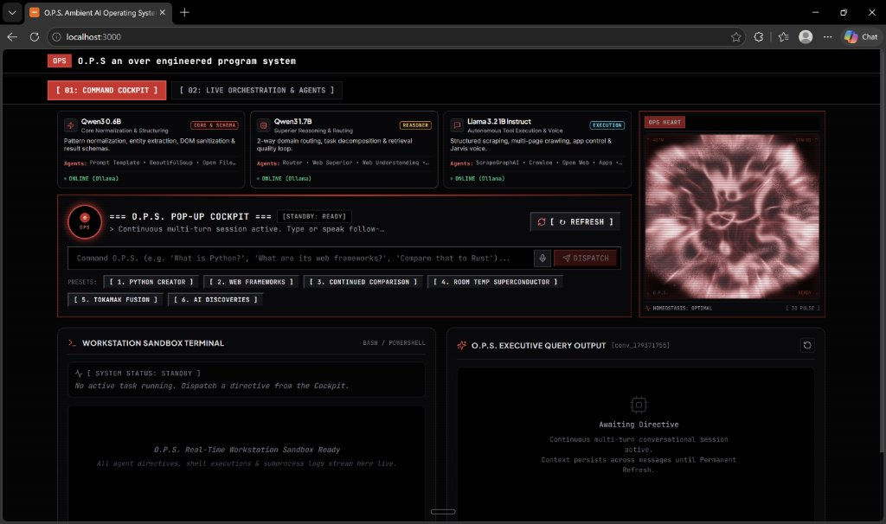
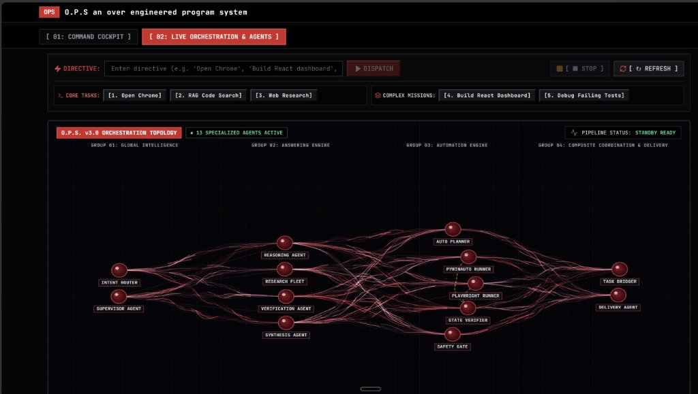
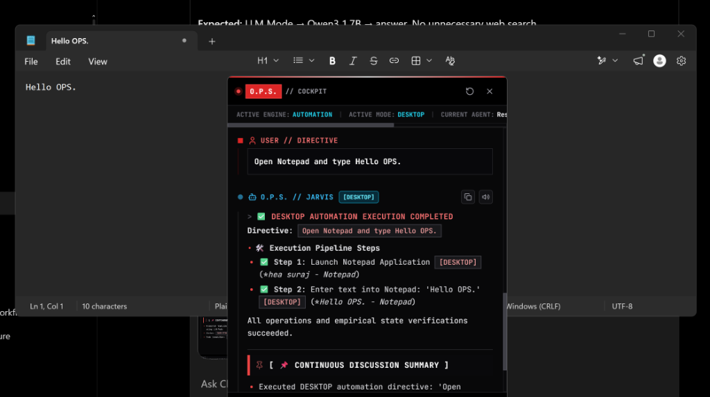
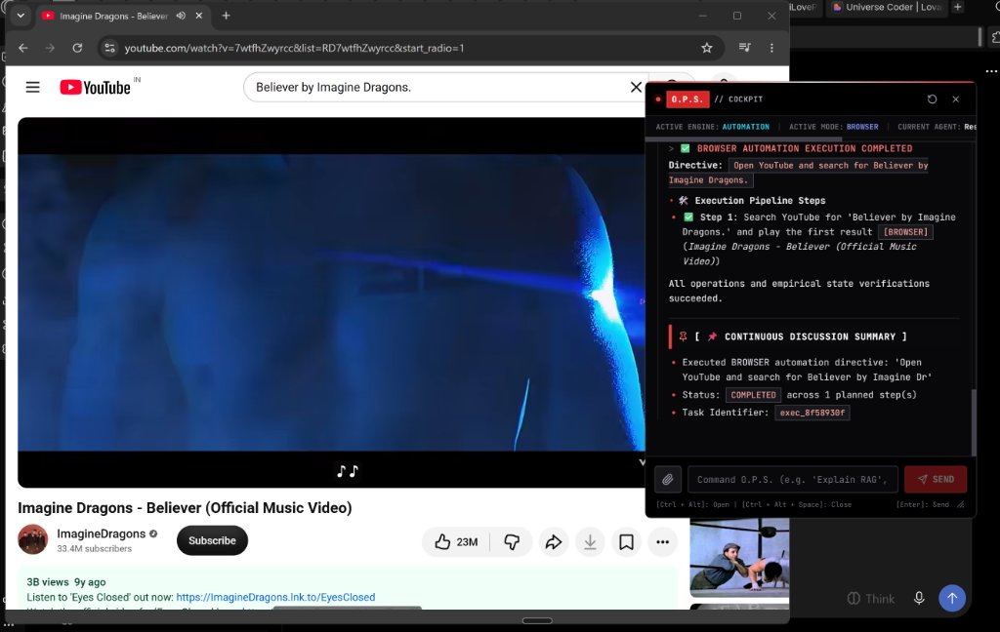
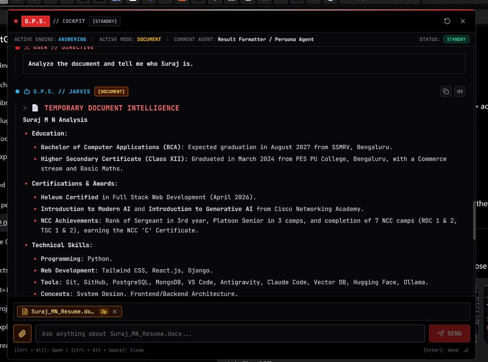
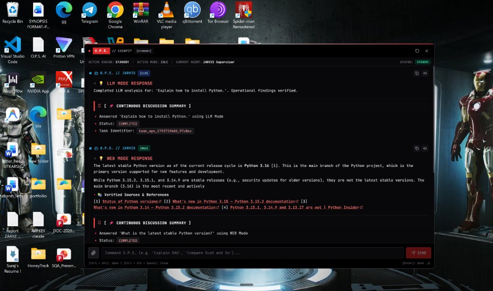

# ⚡ O.P.S. 2.0 — Over-Engineered Programmed System

> *"Your personal AI built to do more than it should."*



[](https://github.com/langchain-ai/langgraph)
[](https://react.dev/)
[](https://www.djangoproject.com/)
[](https://ollama.com/)
[](https://www.pinecone.io/)
[](https://playwright.dev/)
[](https://crawlee.dev/python/)

---

## 🌟 What is O.P.S. 2.0?

**O.P.S. (Over-Engineered Programmed System) 2.0** is a local-first, autonomous personal AI operating system engineered for your workstation. Unlike standard chatbots that only produce text, O.P.S. 2.0 acts as an intelligent digital co-pilot capable of understanding natural language directives, selecting the optimal execution strategy, performing deep research, reasoning locally, and **autonomously executing complex workflows across Windows desktop applications and web browsers**.

Whether you need complex programming logic, verified live web intelligence, hands-free desktop automation, or temporary document analysis, O.P.S. 2.0 handles it through a **hierarchical multi-agent automation architecture** coordinated by LangGraph, rendering real-time execution telemetry through an ultra-responsive, retro-futuristic **Pop-up Cockpit HUD**.

---

## 📸 User Interface Gallery

| **Ambient Operating System Dashboard** | **13-Component Agent Topology Canvas** |
| :---: | :---: |
|  |  |
| *Full-screen mission control with Tri-Model telemetry & Ops Heart* | *Live HTML5 canvas with neural axons and glint telemetry* |

| **Desktop Automation (Pywinauto)** | **Browser Automation (Playwright)** |
| :---: | :---: |
|  |  |
| *Native Windows Notepad launch, keyboard actuation & verification* | *Playwright Chromium navigation, YouTube search & playback* |

| **Temporary Document RAG Intelligence** | **Standalone Pop-up Cockpit HUD** |
| :---: | :---: |
|  |  |
| *Grounded Word & PDF QA with Pinecone vector retrieval* | *Continuous desktop overlay with LLM & Web modes* |

---

## 🚀 What's New in O.P.S. 2.0: Multi-Agent Automation System

The latest O.P.S. 2.0 upgrade introduces a major architectural leap forward: a **hierarchical, multi-agent automation engine** that splits macroscopic automation requests into specialist sub-agents, coordinated by superior fleet commanders, backed by a DAG-based hybrid scheduler, a 6-stage reasoning pipeline, and a redesigned web crawling engine.

```
                                  ┌─────────────────────────────┐
                                  │   USER NATURAL DIRECTIVE    │
                                  └──────────────┬──────────────┘
                                                 │
                                                 ▼
                                  ┌─────────────────────────────┐
                                  │ [A01] Global Intent Router  │  <-- Qwen3 0.6B Fast (<100ms)
                                  └──────────────┬──────────────┘
                                                 │
                                                 ▼
                                  ┌─────────────────────────────┐
                                  │ [A02] Task Understanding &  │  <-- 6-Stage Reasoning Pipeline
                                  │       Planning Engine       │      (Context, Engine, Invariants)
                                  └──────────────┬──────────────┘
                                                 │
                  ┌──────────────────────────────┼──────────────────────────────┐
                  ▼                              ▼                              ▼
      ┌───────────────────────┐      ┌───────────────────────┐      ┌───────────────────────┐
      │   ANSWERING ENGINE    │      │  AUTOMATION ENGINE    │      │  COMPOSITE WORKFLOW   │
      └───────────┬───────────┘      └───────────┬───────────┘      └───────────┬───────────┘
                  │                              │                              │
         ┌────────┴────────┐            ┌────────┴────────┐                     │
         ▼                 ▼            ▼                 ▼                     │
  [A08] Local LLM    [A09] Web R&D   [BSA] Browser    [DSA] Desktop             │
  (Qwen3 1.7B)       (Crawlee+BS4)   Superior Fleet   Superior Fleet            │
                           │         (B01 – B08)      (D01 – D08)               │
                           │                  \        /                        │
                           │             ┌─────▼──────▼─────┐                   │
                           │             │ [A16] Hybrid DAG │<──────────────────┘
                           │             │   Coordinator    │
                           │             └─────────┬────────┘
                           │                       │
                           ▼                       ▼
                     [A14] Grounded          [A20] HITL Safety &
                     Synthesis               [A21] Verification
                           \                       /
                            ▼                     ▼
                       ┌───────────────────────────────┐
                       │  [A22] Result Formatter /     │
                       │        O.P.S. Cockpit HUD     │
                       └───────────────────────────────┘
```

---

## 🤖 The Hierarchical Multi-Agent Fleets

### 1. 🌐 Browser Superior Fleet (`B01–B08`)
Led by the `BrowserSuperiorAgent`, this fleet orchestrates resilient web interaction through a dedicated thread-affined Playwright worker (`OPS-PlaywrightWorker`), preventing cross-thread event loop deadlocks:

| Agent ID | Sub-Agent Specialist | Implementation File | Key Operational Responsibilities |
|:---:|:---|:---|:---|
| **B01** | **Browser Lifecycle** | `b1_lifecycle_agent.py` | Launches, manages, reuses, and gracefully terminates persistent Chromium contexts with isolated user data profiles. |
| **B02** | **Tab Management** | `b2_tab_agent.py` | Creates, tracks, indexes, switches, and closes browser tabs with multi-page state preservation. |
| **B03** | **Navigation** | `b3_navigation_agent.py` | Dispatches URLs, manages back/forward history, handles reloads, and asserts `domcontentloaded` / network idle states. |
| **B04** | **Web Interaction** | `b4_interaction_agent.py` | Locates elements, handles auto-scrolling into viewports, performs safe clicks, hovers, and multi-option selection. |
| **B05** | **Form & Data Entry** | `b5_form_agent.py` | Fills input fields, validates entered values via DOM inspection, toggles checkboxes/radios, and holds submission pending approval. |
| **B06** | **Download & Transfer** | `b6_transfer_agent.py` | Tracks active file downloads, verifies byte counts and MIME types on disk, and handles multipart file uploads. |
| **B07** | **Browser Verification** | `b7_verification_agent.py` | Asserts post-action states (URL validation, DOM presence checks, page title confirmation, visual checks). |
| **B08** | **Browser Recovery** | `b8_recovery_agent.py` | Catches transient navigation errors, handles timeouts with exponential backoff, dismisses unexpected dialogs, and restarts contexts when stalled. |

### 2. 🖥️ Desktop Superior Fleet (`D01–D08`)
Led by the `DesktopSuperiorAgent`, this fleet manages native Windows operating system tasks via Pywinauto (Win32 and UI Automation backends) alongside Windows shell hooks:

| Agent ID | Sub-Agent Specialist | Implementation File | Key Operational Responsibilities |
|:---:|:---|:---|:---|
| **D01** | **Application Control** | `d1_app_agent.py` | Launches standard Win32 executables and Windows 11 packaged UWP apps (`shell:AppsFolder`), handles window reuse, and manages clean termination. |
| **D02** | **Window Management** | `d2_window_agent.py` | Locates window handles (`hwnd`), brings targets to the foreground, toggles focus, minimizes, maximizes, and restores windows. |
| **D03** | **GUI Interaction** | `d3_gui_agent.py` | Traverses accessibility control trees, inspects UIA elements, clicks native buttons, and navigates complex dialog menus. |
| **D04** | **File & Folder** | `d4_file_agent.py` | Normalizes paths, creates directories atomically, writes files, performs renames, moves, and manages approved deletions. |
| **D05** | **Keyboard & Input** | `d5_input_agent.py` | Performs reliable text entry via UIA `ValuePattern.SetValue` with fallback keyboard emulation, executing hotkeys (`Ctrl+S`, `Enter`). |
| **D06** | **Code Generation** | `d6_code_agent.py` | Synthesizes Python, JavaScript, HTML, and CSS source code using `Qwen3 1.7B`, validates syntax via AST parsers, and writes clean files. |
| **D07** | **Desktop Verification** | `d7_verification_agent.py` | Performs deterministic verification of filesystem states (`os.path.exists`, non-zero size), window existence, and running processes (`psutil`). |
| **D08** | **Desktop Recovery** | `d8_recovery_agent.py` | Handles missing window titles, recovers from locked input patterns, gracefully clears stuck dialogs, and manages retry attempts. |

### 3. 🔀 Hybrid Automation Coordinator (`A16–A19`)
For workflows requiring both desktop and browser capabilities (e.g., searching for documentation online, downloading a file, creating a project folder, and opening it in VS Code):
- **DAG Dependency Graph (`DAGTaskGraph`)**: Parses multi-step workflows into directed acyclic dependency trees, automatically resolving prerequisite tasks before downstream actions start.
- **Resource Locking**: Employs hardware and application locks (`LOCK_BROWSER`, `LOCK_DESKTOP`, `LOCK_FILESYSTEM`) to prevent concurrent race conditions.
- **Concurrent Thread Dispatch**: Dispatches independent tasks (e.g., launching an IDE while navigating to documentation) concurrently across a managed `ThreadPoolExecutor`.
- **Live State Tracker (`ExecutionTracker`)**: Tracks per-subtask execution status, start/end timestamps, step outcomes, and error payloads.

### 4. 🕷️ Redesigned Web Research Engine (Crawlee + BeautifulSoup4)
O.P.S. 2.0 replaces basic HTTP scraping with an enterprise-grade retrieval pipeline:
- **Crawlee Integration (`crawling_worker.py`)**: Utilizes `crawlee.beautifulsoup_crawler.BeautifulSoupCrawler` for concurrent, polite, and resilient web crawls with automatic header rotation and redirect handling.
- **BeautifulSoup4 Extraction (`content_extraction_worker.py`)**: Strips scripts, ads, and boilerplate; parses semantic headings (`h1`–`h4`), content paragraphs, markdown tables, and authoritative links.
- **Canonical Source Grounding (`[S1]`, `[S2]`)**: Compiles structured evidence chunks with permanent citation identifiers, verified by the `EvidenceValidationAgent` to prevent synthetic hallucinations.

### 5. 🧠 6-Stage Prompt Understanding & Reasoning Pipeline
The `AdvancedPromptUnderstandingAgent` replaces simple keyword matching with an intelligent 6-stage pipeline:
1. **Context Resolution (`context_resolver.py`)**: Resolves pronouns, follow-ups, and accumulated constraints across conversational turns.
2. **Intent & Goal Decomposition (`prompt_engine.py`)**: Uses `Qwen3 1.7B` to decompose prompts into structured action contracts.
3. **Entity & Parameter Extraction**: Isolates target applications, paths, URLs, file names, programming languages, and flags.
4. **Constraint Enforcement**: Guarantees safety rules (e.g., `do not overwrite`, `read-only`, `preservation of existing code`).
5. **Mathematical Invariant Validation (`validator.py`)**: Enforces deterministic routing invariants across task types (`ANSWER`, `AUTOMATION`, `COMPOSITE`, `CLARIFICATION`).
6. **Clarification Triggering**: Halts execution and politely requests clarification if critical parameters (such as ambiguous project paths) are missing.

---

## 🏛️ The Central 13 LangGraph Orchestrators

At the core of O.P.S. 2.0 is the centralized, stateful **LangGraph multi-agent architecture**:


```
┌────────────────────────────────────────────────────────────────────────┐
│                        O.P.S. 2.0 MULTI-AGENT FLEET                     │
├────────────────────────────────────────────────────────────────────────┤
│ GROUP 01: GLOBAL INTELLIGENCE                                          │
│   ├── [01] Global Intent Router (Qwen3 0.6B Fast Classifier)          │
│   └── [02] Task Understanding & Planner (Qwen3 1.7B Orchestrator)      │
│                                                                        │
│ GROUP 02: ANSWERING ENGINE                                             │
│   ├── [03] Local Reasoning Agent (Qwen3 1.7B Local Reasoner)          │
│   ├── [04] Web Research Agent (Crawlee + BeautifulSoup4 Pipeline)      │
│   ├── [05] Evidence Validation Agent (Cross-Domain Fact Verifier)      │
│   └── [06] Answer Synthesis Agent (Multi-Source Coherence Engine)      │
│                                                                        │
│ GROUP 03: AUTOMATION ENGINE                                            │
│   ├── [07] Automation Planner (Deterministic Action Sequencer)         │
│   ├── [08] Desktop Superior Agent (Pywinauto D01–D08 Fleet)            │
│   ├── [09] Browser Superior Agent (Playwright B01–B08 Fleet)          │
│   ├── [10] Automation Verification & Recovery (Post-Action Verifier)   │
│   └── [11] Human-in-the-Loop Safety Controller (Security Gatekeeper)   │
│                                                                        │
│ GROUP 04: COMPOSITE COORDINATION & DELIVERY                            │
│   ├── [12] Composite Task Coordinator (Research + Automation Bridge)   │
│   └── [13] Result Formatter / O.P.S. Persona (JARVIS Output Engine)    │
└────────────────────────────────────────────────────────────────────────┘
```

---

## 🚀 Core Capabilities

### 1. 💡 Answering Engine (3 Adaptive Modes)


- **LLM Mode**: Uses the local `Qwen3 1.7B` model for instant, completely offline answers to conceptual, mathematical, and programming queries. Zero telemetry leaves your machine.
- **Web Mode**: Discovers fresh external intelligence via DuckDuckGo, crawls pages using **Crawlee**, extracts structured content with **BeautifulSoup4**, cross-verifies facts, and delivers structured answers with clickable references (`[S1]`, `[S2]`).
- **Hybrid Mode**: Simultaneously forks execution to local reasoning and live web research, converging at the synthesizer to produce deep, context-rich analysis grounded in verified facts.

### 2. 🤖 Dual-Engine Workstation Automation

#### A. Desktop Automation (Pywinauto & Win32 Fleet)
Hands-free control over native Windows software (`Notepad`, `Calculator`, `VS Code`, `File Explorer`, system dialogs, custom applications).


#### B. Browser Automation (Playwright Fleet)
Headless or headed Chromium automation capable of navigating complex modern web apps, clicking interactive controls, searching YouTube, playing requested media, and downloading files.


#### C. Hybrid & Composite Workflows
Seamlessly executes cross-engine tasks, such as finding a release number online, downloading the installer in a browser, creating directories, and launching software locally.

### 3. 📄 Temporary Document RAG with Pinecone


- **Supported Documents**: Accepts PDF (`.pdf`) and Microsoft Word (`.docx`, `.doc`) documents up to 25 MB directly through the Cockpit paperclip button.
- **Local Dense Embeddings**: Generates 768-dimensional vector embeddings locally using `nomic-embed-text` in `~112 ms`.
- **Serverless Vector Indexing**: Indexes chunks into conversation-isolated namespaces in Pinecone (`ops-temporary-rag`).
- **Strict Grounding & Honest Refusal**: Answers strictly cite document page and section numbers, and explicitly refuse to extrapolate when information is absent.
- **Guaranteed Ephemeral Deletion**: In-memory chunk text and Pinecone vectors are permanently wiped upon clicking **Refresh**, confirmed by `describe_index_stats (vector_count == 0)`.

### 4. 🎛️ Dynamic Pop-up Cockpit HUD
- **Tactical Retro Design**: Monospaced font, glowing status indicators, sound effects, and floating HUD styling.
- **Draggable Header**: Click and drag the tactical top bar to move the Cockpit anywhere across multiple displays.
- **Dynamic 8-Axis Resizing**: Fluidly resize the window from 400×520 px to 1600×1800 px with a live HUD dimension badge.
- **Global Hotkeys**: Quick-access shortcuts (`Ctrl + Alt` to open, `Ctrl + Alt + Space` to close).
- **Real-Time Token Streaming**: Text typewriter SSE stream delivers words as they are generated.

### 5. 🛡️ Human-in-the-Loop Safety Controller
- **Security Interception**: Destructive commands (file system modifications, bulk deletions, process termination) are automatically paused by Agent 11.
- **Approval Queue**: Renders an interactive confirmation dialog requiring explicit user clearance (`CONFIRM` or `DENY`) before physical execution.

---

## 🛠️ Technology Stack

| Layer | Technologies |
| :--- | :--- |
| **Multi-Agent Orchestrator** | [LangGraph](https://github.com/langchain-ai/langgraph), [LangChain](https://www.langchain.com/), `MemorySaver` |
| **Automation Sub-Agent Fleets** | **Browser Fleet (`B01–B08`)**, **Desktop Fleet (`D01–D08`)**, **Hybrid DAG Coordinator** |
| **Web Crawling & Parsing** | [Crawlee](https://crawlee.dev/python/) (`BeautifulSoupCrawler`), [BeautifulSoup4](https://www.crummy.com/software/BeautifulSoup/) |
| **Local Model Fleet** | [Ollama](https://ollama.com/) (`Qwen3 0.6B Q8_0`, `Qwen3 1.7B Q8_0`, `Llama 3.2 1B`, `nomic-embed-text`) |
| **Vector Database** | [Pinecone Serverless](https://www.pinecone.io/) (AWS `us-east-1`, 768 dimensions, Cosine metric) |
| **Desktop Automation** | [Pywinauto](https://pywinauto.readthedocs.io/) (Win32 & UI Automation backends) |
| **Browser Automation** | [Playwright](https://playwright.dev/) (Chromium) |
| **Backend Framework** | [Django 5](https://www.djangoproject.com/), Django REST Framework, Server-Sent Events (SSE), SQLite WAL |
| **Frontend Framework** | [React 18](https://react.dev/), [Vite](https://vitejs.dev/), [Tailwind CSS](https://tailwindcss.com/), Lucide Icons, HTML5 Canvas |
| **Document Processing** | `pypdf`, `python-docx`, `reportlab` |

---

## ⚡ Quickstart & Installation

### Prerequisites
- **Operating System**: Windows 10 or Windows 11 (64-bit)
- **Python**: Python 3.10 – 3.12 recommended
- **Node.js**: Node 18+ and npm
- **Ollama**: Installed and running locally ([Download Ollama](https://ollama.com/))

### 1. Clone the Repository
```bash
git clone https://github.com/sn740698-cell/O.P.S.git
cd O.P.S
```

### 2. Pull Required Ollama Models
```bash
ollama pull hf.co/Qwen/Qwen3-0.6B-GGUF:Q8_0
ollama pull hf.co/Qwen/Qwen3-1.7B-GGUF:Q8_0
ollama pull hf.co/hugging-quants/Llama-3.2-1B-Instruct-Q8_0-GGUF:Q8_0
ollama pull nomic-embed-text
```

### 3. Backend Setup
```bash
cd backend
python -m venv venv
venv\Scripts\activate
pip install -r requirements.txt
playwright install chromium
python manage.py migrate
```

Configure your environment variables in `backend/.env`:
```env
PINECONE_API_KEY=your_pinecone_api_key_here
PINECONE_INDEX_NAME=ops-temporary-rag
EMBEDDING_MODEL=nomic-embed-text
EMBEDDING_DIMENSION=768
OLLAMA_BASE_URL=http://localhost:11434
```

Start the Django API backend:
```bash
python manage.py runserver 0.0.0.0:8000
```

### 4. Frontend Setup
In a new terminal:
```bash
cd frontend
npm install
npm run dev
```

### 5. Access O.P.S. 2.0
- **Ambient AI OS Dashboard**: Open [http://localhost:3000](http://localhost:3000)
- **Standalone Pop-up Cockpit HUD**: Open [http://localhost:3000/?mode=cockpit](http://localhost:3000/?mode=cockpit)

---

## 📜 License & Acknowledgments

Engineered as part of the **O.P.S. (Over-Engineered Programmed System)** initiative. Built with modern open-source foundations including LangGraph, Crawlee, BeautifulSoup4, Ollama, Pywinauto, Playwright, React, and Django.
