# ⚡ O.P.S. 2.0 — Over-Engineered Programmed System

> *"Your personal autonomous AI operating system built to do far more than it should."*

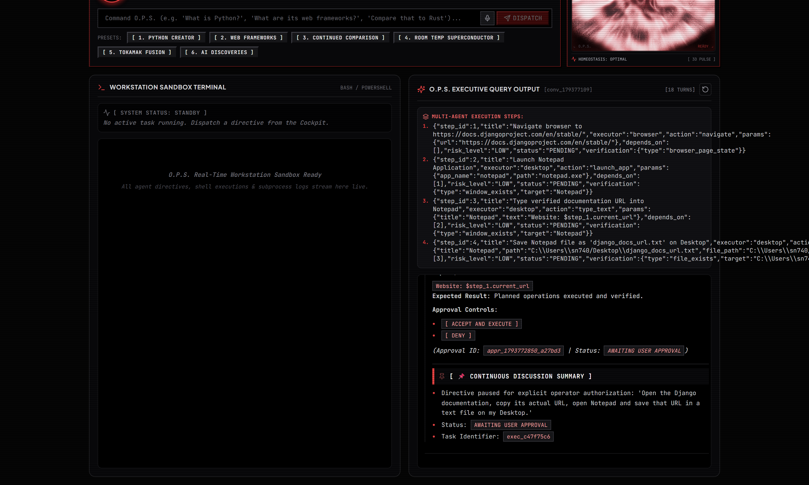

[](https://github.com/langchain-ai/langgraph)
[](https://react.dev/)
[](https://www.djangoproject.com/)
[](https://ollama.com/)
[](https://www.pinecone.io/)
[](https://playwright.dev/)
[](https://pywinauto.readthedocs.io/)
[](https://github.com/sn740698-cell/O.P.S)

---

## 🌟 What is O.P.S.?

**O.P.S. (Over-Engineered Programmed System)** is a local-first, autonomous personal AI operating system engineered for your workstation. Unlike standard chatbots that only produce text, O.P.S. acts as an intelligent digital co-pilot capable of understanding natural language directives, selecting the optimal execution strategy, performing deep research, reasoning locally, and **autonomously executing tasks across Windows desktop software and web browsers**.

Whether you need complex programming logic, verified live web intelligence, hands-free desktop automation, or temporary document analysis, O.P.S. handles it through a **stateful 13-component LangGraph multi-agent fleet** protected by a mandatory **Global Human-in-the-Loop (HITL) Approval Gate**, rendered in real time through an ultra-responsive, retro-futuristic **Pop-up Cockpit HUD** and full **Ambient OS Dashboard**.

---

## 📸 Comprehensive Live UI & Execution Gallery

All screenshots below represent **real, live task executions** across every mode and engine in the running O.P.S. 2.0 system:

### 1. The Six Core Execution Modes

| **[Mode 01] LLM Reasoning Mode** | **[Mode 02] Web Research Mode** |
| :---: | :---: |
| 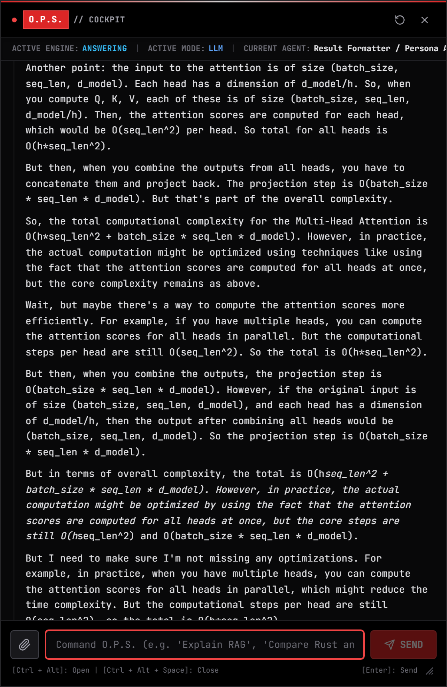 | 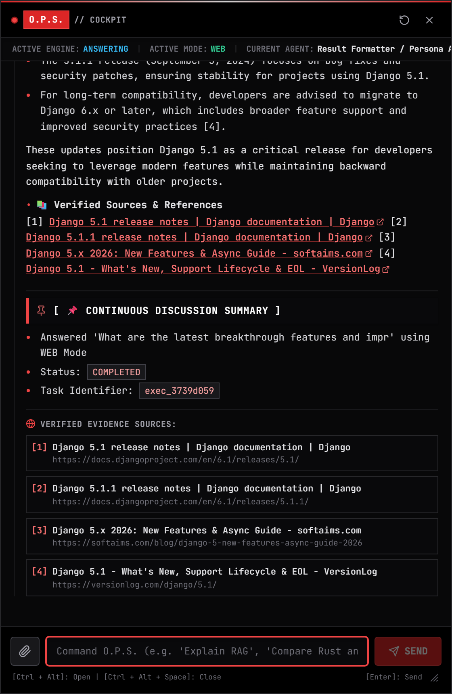 |
| *Local Qwen3 1.7B mathematical analysis of Multi-Head Attention complexity* | *Live web research on Django 5.1 & Python 3.13 with clickable citations* |

| **[Mode 03] Hybrid Reasoning Mode** | **[Mode 04] Desktop Automation Mode** |
| :---: | :---: |
| 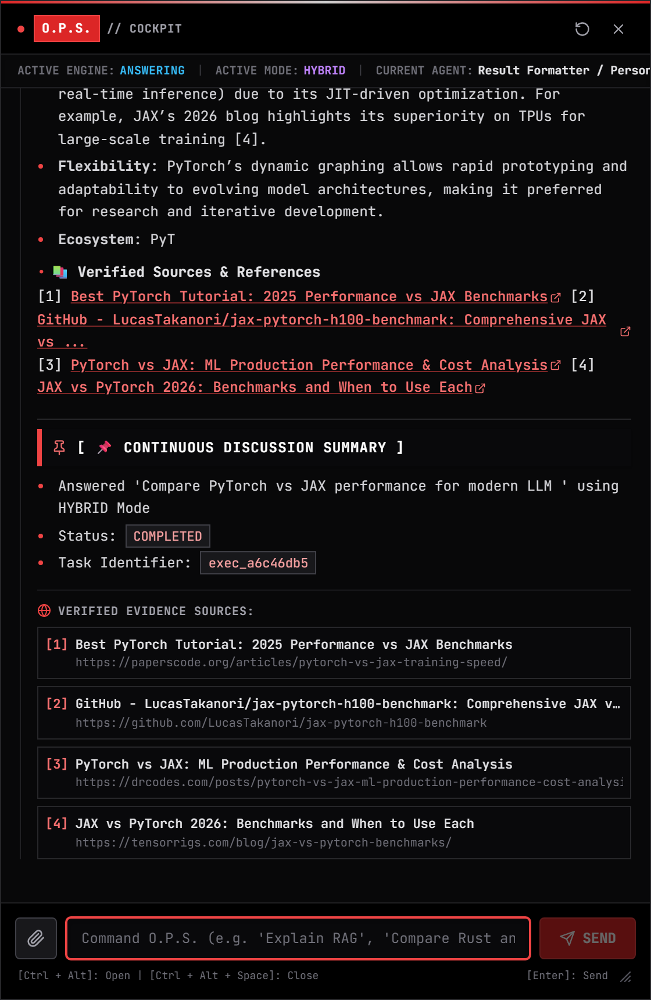 | 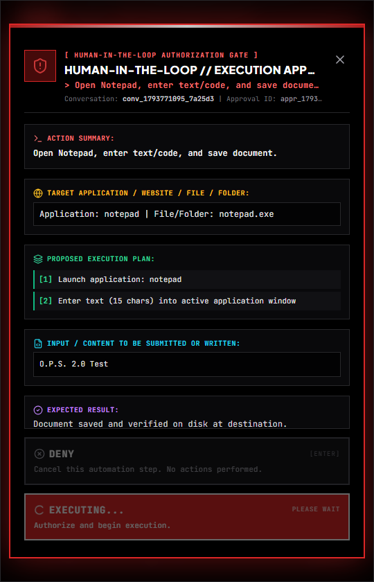 |
| *Dual-branch local reasoning + web intelligence synthesis (PyTorch vs JAX)* | *Native Windows Notepad launch, keyboard actuation, and file persistence* |

| **[Mode 05] Browser Automation Mode** | **[Mode 06] Hybrid Automation Mode** |
| :---: | :---: |
| 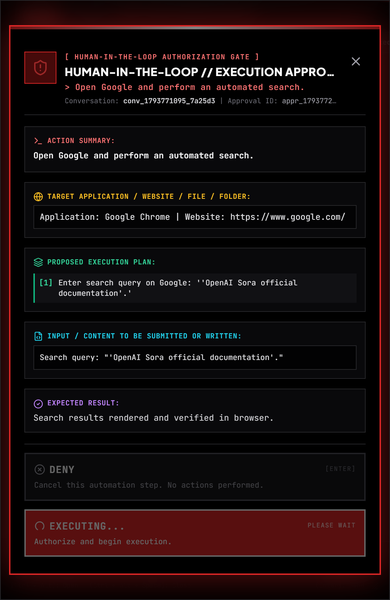 | 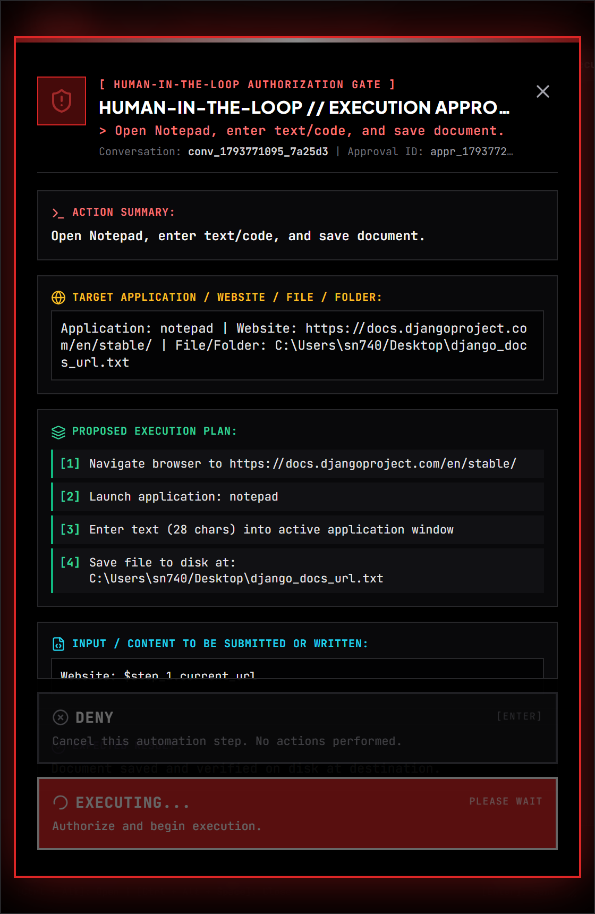 |
| *Playwright Chromium navigation and organic Google search inspection* | *Cross-engine pipeline: browser documentation scraping ➔ desktop Notepad save* |

---

### 2. Global Human-in-the-Loop (HITL) Security & Workspace Views

| **Mandatory HITL Execution Approval Modal** | **Standalone Pop-up Cockpit Overlay HUD** |
| :---: | :---: |
| 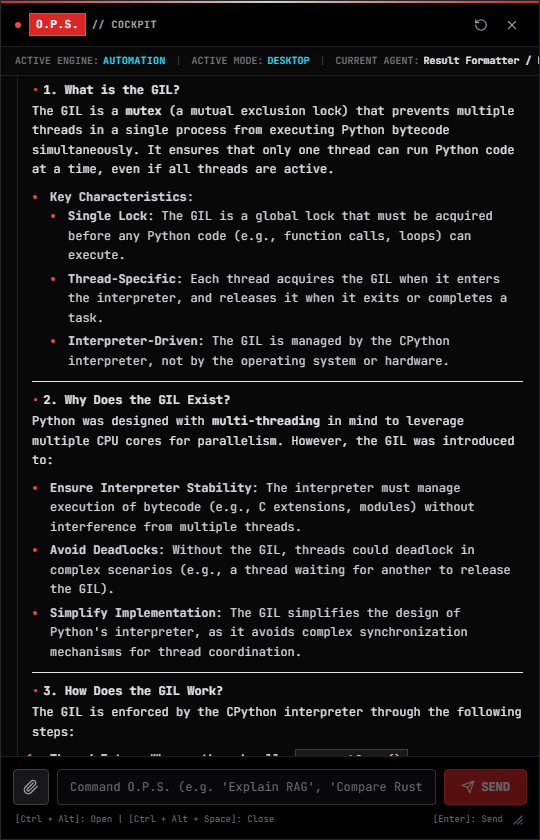 | 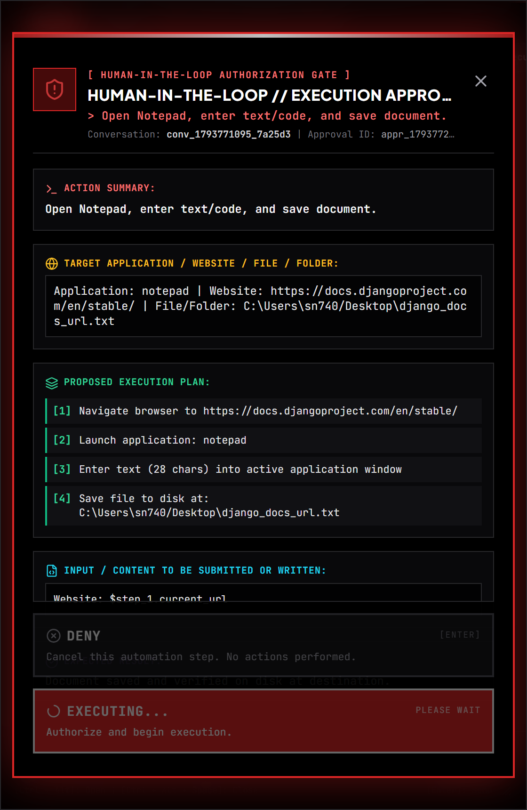 |
| *Zero-trust gate: Action, Target, Plan, Input, & Expected Result with Accept/Deny* | *Tactical floating HUD with 8-axis dynamic resizing and hotkey toggle* |

| **13-Component Agent Topology Canvas** | **Real-Time Agent Inspector Modal** |
| :---: | :---: |
| 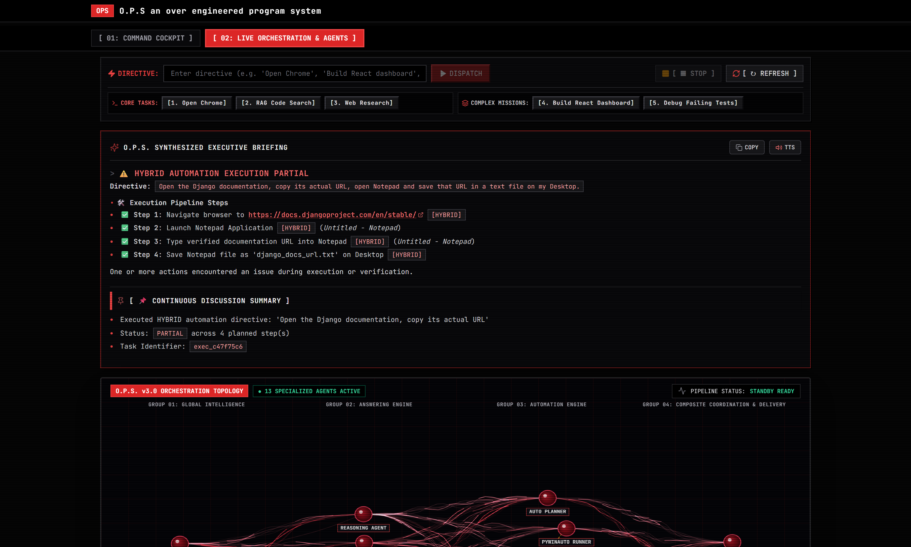 | 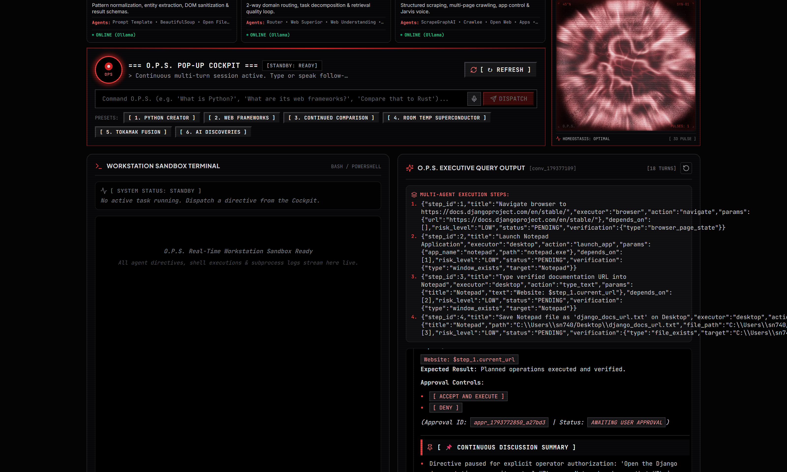 |
| *Live HTML5 canvas with neural axons and glint telemetry* | *Deep execution telemetry, state parameters, and active model assignments* |

| **Temporary Document RAG Intelligence** | **Conversation Wipe & Pinecone Clean** |
| :---: | :---: |
| 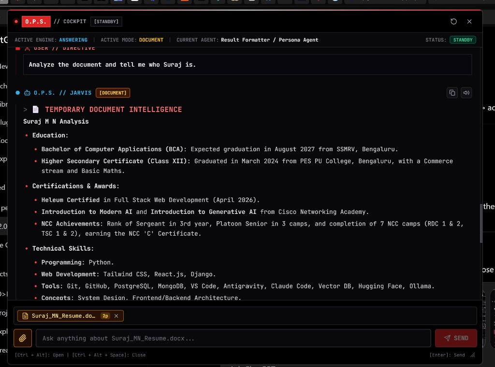 | 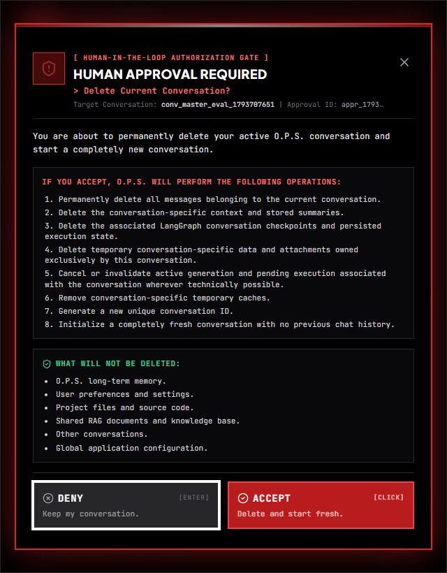 |
| *Grounded PDF & Word QA with explicit page references* | *Confirmed ephemeral vector deletion (`vector_count == 0`)* |

---

## 🛡️ Global Human-in-the-Loop (HITL) Approval Gate

O.P.S. 2.0 enforces a strict **zero-trust security model** for all automation actions. Every action performed by an automation agent—whether ordinary (opening a URL, launching Calculator) or high-risk (file creation, deletion, code generation)—**must receive explicit user authorization prior to execution**.

```
┌────────────────────────────────────────────────────────┐
│  ⚠️  HUMAN-IN-THE-LOOP // EXECUTION APPROVAL           │
│                                                        │
│  ACTION:    Open Google and perform an automated search│
│  TARGET:    Website: https://www.google.com/           │
│             Application: Google Chrome                 │
│                                                        │
│  PLAN:      1. Open Google Chrome                      │
│             2. Navigate to https://www.google.com      │
│             3. Enter search query 'OpenAI Sora'        │
│             4. Verify results page rendered            │
│                                                        │
│  INPUT:     Search query: "OpenAI Sora"                │
│  EXPECTED:  Search results rendered in active browser  │
│                                                        │
│     [ ACCEPT AND EXECUTE ]       [ DENY ] (Focused)    │
└────────────────────────────────────────────────────────┘
```

### Security Architecture Highlights
1. **Three-Layer Defense-in-Depth**:
   - **LangGraph Routing Divergence**: Conditional edge `route_after_safety_controller` detours directly to `result_formatter_agent` when unapproved, bypassing executor nodes.
   - **Executor Pre-flight Assertion**: Both `desktop_automation_executor` and `browser_automation_executor` verify `approval_status == "APPROVED"`. Any unapproved invocation immediately aborts.
   - **Engine Guard**: In `AutomationService.execute_task`, tasks lacking `APPROVAL_APPROVED` are refused with `success: False`.
2. **SHA-256 Plan Hash Integrity**:
   - Every approval card generates a cryptographic hash of the query, targets, and operations.
   - If an agent mutates the plan during execution, the hash becomes invalid, forcing a fresh HITL checkpoint.
3. **Safe Denial Guarantee**:
   - Clicking `[ DENY ]` halts execution immediately: zero windows open, zero browser tabs launch, and zero files are created. Returns `"O.P.S. execution cancelled. No automation actions were performed."`
4. **Verified Against 13 Acceptance Criteria**:
   - End-to-end test suite (`tests_validation/verify_global_hitl_approval_gate.py`) verifies Google Search, YouTube, Spotify, Instagram, Notepad, VS Code, File Creation, Destructive Deletion, Hybrid Workflows, DENY rejection, ACCEPT resumption, and Plan Mutation (**40 PASS | 0 FAIL**).

---

## 🤖 The 13 Canonical Multi-Agents

At the heart of O.P.S. is a centralized, stateful **LangGraph multi-agent architecture** organized across four specialized operational groups:

```
┌────────────────────────────────────────────────────────────────────────┐
│                        O.P.S. 2.0 MULTI-AGENT FLEET                     │
├────────────────────────────────────────────────────────────────────────┤
│ GROUP 01: GLOBAL INTELLIGENCE                                          │
│   ├── [01] Global Intent Router (Qwen3 0.6B Fast Classifier)          │
│   └── [02] Task Understanding & Planner (Qwen3 1.7B Orchestrator)      │
│                                                                        │
│ GROUP 02: ANSWERING ENGINE                                             │
│   ├── [03] Local Reasoning Agent (Qwen3 1.7B Local Reasoner)          │
│   ├── [04] Web Research Agent (DuckDuckGo + HTTPX Async Crawlers)      │
│   ├── [05] Evidence Validation Agent (Cross-Domain Fact Verifier)      │
│   └── [06] Answer Synthesis Agent (Multi-Source Coherence Engine)      │
│                                                                        │
│ GROUP 03: AUTOMATION ENGINE                                            │
│   ├── [07] Automation Planner (Deterministic Action Sequencer)         │
│   ├── [08] Desktop Automation Executor (Pywinauto Win32/UIA Engine)    │
│   ├── [09] Browser Automation Executor (Playwright Chromium Engine)    │
│   ├── [10] Automation Verification & Recovery (Post-Action Verifier)   │
│   └── [11] Human-in-the-Loop Safety Controller (Security Gatekeeper)   │
│                                                                        │
│ GROUP 04: COMPOSITE COORDINATION & DELIVERY                            │
│   ├── [12] Composite Task Coordinator (Research + Automation Bridge)   │
│   └── [13] Result Formatter / O.P.S. Persona (JARVIS Output Engine)    │
│                                                                        │
│ SECURITY PERIMETER                                                     │
│   └── [🛡️] Global HITL Approval Gatekeeper (Zero-Trust Action Barrier)  │
└────────────────────────────────────────────────────────────────────────┘
```

---

## 🔄 Execution Pipeline

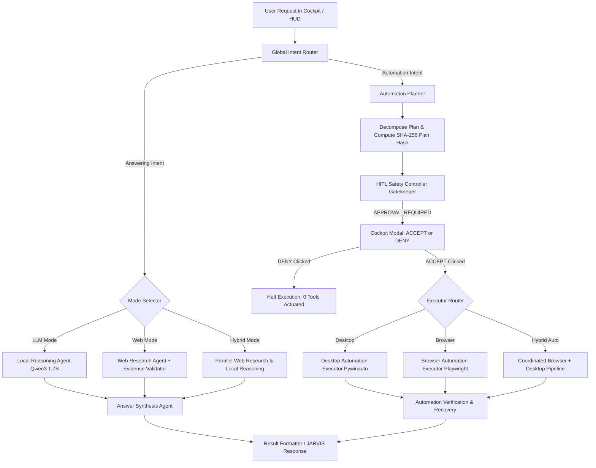

---

## 💻 Recently Updated Code Architecture

### 1. Global HITL Safety Controller (`hitl_safety_controller.py`)
```python
# backend/research_system/orchestrator/agents/hitl_safety_controller.py
if task_type == "AUTOMATION" or any(s.get("executor") in ["desktop", "browser", "system"] for s in steps):
    details = SafetyPolicy.build_automation_hitl_details(
        query=user_request,
        steps=steps,
        mode=state.get("mode", "AUTOMATION")
    )
    # Generate cryptographic plan hash and persist PendingApproval
    approval = PendingApproval.objects.create(
        approval_id=f"appr_{int(time.time())}_{uuid.uuid4().hex[:6]}",
        action_type=f"AUTOMATION_{state.get('mode', 'EXECUTION')}",
        metadata=details,
        status="PENDING"
    )
    # Emit real-time event & pause LangGraph pipeline
    event_bus.publish(EventType.APPROVAL_REQUIRED, details)
    return {
        "approval_required": True,
        "approval_status": "WAITING_FOR_APPROVAL",
        "status": "WAITING_FOR_APPROVAL",
        "pending_approval_id": approval.approval_id
    }
```

### 2. Multi-Step Automation Planning (`automation_planner.py`)
```python
# backend/automation_system/planner/automation_planner.py
if mode == MODE_HYBRID or (any(w in q_lower for w in ["notepad", "file"]) and any(w in q_lower for w in ["browser", "chrome", "docs", "url"])):
    steps = [
        {"step_id": 1, "title": f"Navigate browser to {target_url}", "executor": "browser", "action": "navigate", "params": {"url": target_url}},
        {"step_id": 2, "title": "Launch Notepad Application", "executor": "desktop", "action": "launch_app", "params": {"app_name": "notepad", "path": "notepad.exe"}},
        {"step_id": 3, "title": "Type verified documentation URL into Notepad", "executor": "desktop", "action": "type_text", "params": {"title": "Notepad", "text": "$step_1.current_url"}},
        {"step_id": 4, "title": f"Save Notepad file as '{out_filename}' on Desktop", "executor": "desktop", "action": "save_file", "params": {"path": out_file_path}}
    ]
    return {"status": "READY", "automation_mode": MODE_HYBRID, "steps": steps, "requires_approval": True}
```

### 3. Pre-flight Executor Enforcement (`desktop_automation_executor.py`)
```python
# backend/research_system/orchestrator/agents/desktop_automation_executor.py
if state.get("approval_status") != "APPROVED":
    logger.error("Desktop Automation Executor BLOCKED: Pre-execution approval missing!")
    return {
        "execution_status": "BLOCKED",
        "error_details": "Human-in-the-Loop approval required prior to desktop execution."
    }
```

---

## 🛠️ Technology Stack

| Layer | Technologies |
| :--- | :--- |
| **Multi-Agent Orchestrator** | [LangGraph](https://github.com/langchain-ai/langgraph), [LangChain](https://www.langchain.com/), `MemorySaver` |
| **Local Model Fleet** | [Ollama](https://ollama.com/) (`Qwen3 0.6B Q8_0`, `Qwen3 1.7B Q8_0`, `Llama 3.2 1B`, `nomic-embed-text`) |
| **Vector Database** | [Pinecone Serverless](https://www.pinecone.io/) (AWS `us-east-1`, 768 dimensions, Cosine metric) |
| **Desktop Automation** | [Pywinauto](https://pywinauto.readthedocs.io/) (Win32 & UI Automation backends) |
| **Browser Automation** | [Playwright](https://playwright.dev/) (Chromium headless & headed) |
| **Backend Framework** | [Django 5](https://www.djangoproject.com/), Django REST Framework, Server-Sent Events (SSE), SQLite WAL |
| **Frontend Framework** | [React 18](https://react.dev/), [Vite](https://vitejs.dev/), [Tailwind CSS](https://tailwindcss.com/), Lucide Icons, HTML5 Canvas |
| **Document Processing** | `pypdf`, `python-docx`, `reportlab` |

---

## ⚡ Quickstart & Installation

### Prerequisites
- **Operating System**: Windows 10 or Windows 11 (64-bit)
- **Python**: Python 3.10 – 3.12 recommended
- **Node.js**: Node 18+ and npm
- **Ollama**: Installed and running locally ([Download Ollama](https://ollama.com/))

### 1. Clone the Repository
```bash
git clone https://github.com/sn740698-cell/O.P.S.git
cd O.P.S
```

### 2. Pull Required Ollama Models
```bash
ollama pull hf.co/Qwen/Qwen3-0.6B-GGUF:Q8_0
ollama pull hf.co/Qwen/Qwen3-1.7B-GGUF:Q8_0
ollama pull hf.co/hugging-quants/Llama-3.2-1B-Instruct-Q8_0-GGUF:Q8_0
ollama pull nomic-embed-text
```

### 3. Automated One-Click Windows Launcher
Simply double-click or execute from PowerShell/cmd:
```cmd
windows.bat
```
`windows.bat` automatically verifies prerequisites, confirms Ollama, migrates the database, starts the Django LangGraph backend, launches the Vite frontend, and opens both the **Ambient OS Dashboard** and the **Native Standalone Pop-up Cockpit**.

---

## 📜 License & Acknowledgments

Engineered as part of the **O.P.S. (Over-Engineered Programmed System)** initiative. Built with modern open-source foundations including LangGraph, Ollama, Pywinauto, Playwright, React, and Django.
