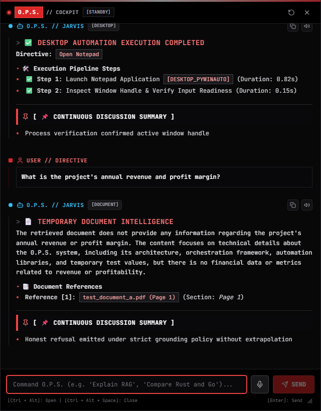
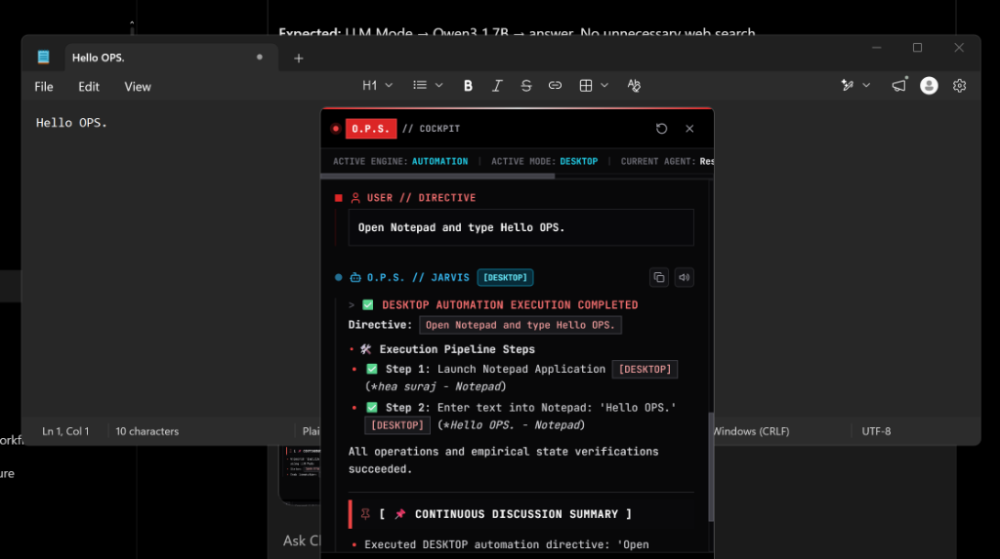

# ⚡ O.P.S. 2.0 — Over-Engineered Programmed System

> *"Your personal AI built to do more than it should."*


[](https://github.com/langchain-ai/langgraph)
[](https://react.dev/)
[](https://www.djangoproject.com/)
[](https://ollama.com/)
[](https://www.pinecone.io/)
[](https://playwright.dev/)

---

## 🌟 What is O.P.S.?

**O.P.S. (Over-Engineered Programmed System)** is a local-first, autonomous personal AI operating system engineered for your workstation. Unlike standard chatbots that only produce text, O.P.S. acts as an intelligent digital co-pilot capable of understanding natural language directives, selecting the optimal execution strategy, performing deep research, reasoning locally, and **autonomously executing tasks across Windows desktop software and web browsers**.

Whether you need complex programming logic, verified live web intelligence, hands-free desktop automation, or temporary document analysis, O.P.S. handles it through a **stateful 13-component LangGraph multi-agent fleet** and renders everything in real time through an ultra-responsive, retro-futuristic **Pop-up Cockpit HUD**.

---

## 📸 User Interface Gallery

| **Ambient Operating System Dashboard** | **Standalone Draggable Pop-up Cockpit** |
| :---: | :---: |
|  |  |
| *Full-screen mission control with Tri-Model telemetry & Ops Heart* | *Tactical floating HUD with dynamic resizing and hotkey toggle* |

| **13-Component Agent Topology Canvas** | **Real-Time Agent Inspector Modal** |
| :---: | :---: |
|  |  |
| *Live HTML5 canvas with neural axons and glint telemetry* | *Deep execution logs, parameters, and assigned models* |

| **Temporary Document RAG Intelligence** | **Web Research with Verified Citations** |
| :---: | :---: |
|  |  |
| *Grounded PDF & Word QA with explicit page references* | *Multi-source scraping with upstream evidence validation* |

| **Desktop Automation (Pywinauto)** | **Human-in-the-Loop Safety Gate** |
| :---: | :---: |
|  |  |
| *Native Windows application launch & window verification* | *Intercepts destructive actions & confirms session refreshes* |

---

## 🤖 The 13 Canonical Multi-Agents

At the heart of O.P.S. is a centralized, stateful **LangGraph multi-agent architecture** organized across four specialized operational groups:

```
┌────────────────────────────────────────────────────────────────────────┐
│                        O.P.S. 2.0 MULTI-AGENT FLEET                     │
├────────────────────────────────────────────────────────────────────────┤
│ GROUP 01: GLOBAL INTELLIGENCE                                          │
│   ├── [01] Global Intent Router (Qwen3 0.6B Fast Classifier)          │
│   └── [02] Task Understanding & Planner (Qwen3 1.7B Orchestrator)      │
│                                                                        │
│ GROUP 02: ANSWERING ENGINE                                             │
│   ├── [03] Local Reasoning Agent (Qwen3 1.7B Local Reasoner)          │
│   ├── [04] Web Research Agent (DuckDuckGo + HTTPX Async Crawlers)      │
│   ├── [05] Evidence Validation Agent (Cross-Domain Fact Verifier)      │
│   └── [06] Answer Synthesis Agent (Multi-Source Coherence Engine)      │
│                                                                        │
│ GROUP 03: AUTOMATION ENGINE                                            │
│   ├── [07] Automation Planner (Deterministic Action Sequencer)         │
│   ├── [08] Desktop Automation Executor (Pywinauto Win32/UIA Engine)    │
│   ├── [09] Browser Automation Executor (Playwright Chromium Engine)    │
│   ├── [10] Automation Verification & Recovery (Post-Action Verifier)   │
│   └── [11] Human-in-the-Loop Safety Controller (Security Gatekeeper)   │
│                                                                        │
│ GROUP 04: COMPOSITE COORDINATION & DELIVERY                            │
│   ├── [12] Composite Task Coordinator (Research + Automation Bridge)   │
│   └── [13] Result Formatter / O.P.S. Persona (JARVIS Output Engine)    │
└────────────────────────────────────────────────────────────────────────┘
```

### Agent Responsibilities in Detail

1. **Global Intent Router (`global_intent_router.py`)**: Uses `Qwen3 0.6B` and regex heuristics to evaluate input in $< 100\text{ ms}$. Classifies directives into `ANSWER` (`LLM`, `WEB`, `HYBRID`, `DOCUMENT`), `AUTOMATION` (`DESKTOP`, `BROWSER`, `HYBRID_AUTO`), `COMPOSITE`, or `CLARIFICATION`.
2. **Task Understanding and Planning Agent (`task_understanding_planner.py`)**: Decomposes directives into multi-step execution plans, identifies data dependencies, and flags required security checkpoints.
3. **Local Reasoning Agent (`local_reasoning_agent.py`)**: Harnesses `Qwen3 1.7B` for private, deep logical reasoning, code syntax generation, and grounded document analysis without internet lookups.
4. **Web Research Agent (`web_research_agent.py`)**: Queries search providers, scrapes live web pages via an asynchronous `httpx` connection pool, and extracts candidate evidence snippets.
5. **Evidence Validation Agent (`evidence_validation_agent.py`)**: Cross-verifies claims across retrieved domains, discards conflicting statements, and calculates factual confidence scores.
6. **Answer Synthesis Agent (`answer_synthesis_agent.py`)**: Synthesizes verified external facts with local reasoning context into cohesive, well-formatted answers.
7. **Automation Planner (`automation_planner_agent.py`)**: Translates high-level tasks into executable UI actions, selectors, mouse clicks, and keystrokes.
8. **Desktop Automation Executor (`desktop_automation_executor.py`)**: Utilizes `Pywinauto` to launch desktop software, interact with window handles, and manipulate controls on Windows.
9. **Browser Automation Executor (`browser_automation_executor.py`)**: Utilizes `Playwright` to navigate websites, fill forms, download files, and scrape dynamic DOM trees.
10. **Automation Verification and Recovery (`verification_recovery_agent.py`)**: Inspects application states post-execution to verify that windows opened, pages loaded, or operations completed successfully.
11. **Human-in-the-Loop and Safety Controller (`hitl_safety_controller.py`)**: Enforces strict safety policies. Intercepts destructive actions (file deletion, formatting, registry edits) and holds execution until explicit user approval.
12. **Composite Task Coordinator (`composite_task_coordinator.py`)**: Bridges research intelligence and automation actions (e.g. search online for the latest installer, download it, and launch it locally).
13. **Result Formatter / O.P.S. Persona (`result_formatter_agent.py`)**: Delivers all responses in an articulate, calm, confident JARVIS-style tone, attaching markdown formatting, verified source links, and the audit section `## 📌 Discussion So Far`.

---

## 🔄 How It Works: The Execution Pipeline

```
 User Input (from Pop-up Cockpit or Voice)
               │
               ▼
 ┌───────────────────────────┐
 │ 01. Global Intent Router  │  <-- Classifies intent in <100ms
 └─────────────┬─────────────┘
               ▼
 ┌───────────────────────────┐
 │ 02. Task Planner & Supv   │  <-- Decomposes mission plan
 └─────────────┬─────────────┘
               │
               ├───────────────────┬───────────────────┬───────────────────┐
               ▼                   ▼                   ▼                   ▼
        [ LLM / DOCUMENT ]       [ WEB RESEARCH ]     [ AUTOMATION ]      [ COMPOSITE ]
               │                   │                   │                   │
         03. Local Reasoner   04. Web Agent      07. Auto Planner    12. Composite Coord
               │                   │                   │                   │
               │              05. Validator       11. Safety Gate    (Loops 04 -> 07)
               │                   │                   │                   │
               │              06. Synthesizer     08/09. Executors         │
               │                   │                   │                   │
               │                   │              10. Verification         │
               │                   │                   │                   │
               └───────────────────┴───────────────────┴───────────────────┘
                                           │
                                           ▼
                            ┌─────────────────────────────┐
                            │ 13. Result Formatter Agent  │
                            └──────────────┬──────────────┘
                                           │
                                           ▼ Real-Time SSE Token Stream
                            ┌─────────────────────────────┐
                            │    O.P.S. Pop-up Cockpit    │
                            └─────────────────────────────┘
```

---

## 🚀 Core Capabilities

### 1. 💡 Answering Engine (3 Adaptive Modes)
- **LLM Mode**: Uses the local `Qwen3 1.7B` model for instant, completely offline answers to conceptual, mathematical, and programming queries. Zero telemetry leaves your machine.
- **Web Mode**: Discovers fresh external intelligence via DuckDuckGo and asynchronous web scrapers, cross-verifies facts, and delivers structured answers with clickable references.
- **Hybrid Mode**: Simultaneously forks execution to local reasoning and live web research, converging at the synthesizer to produce deep, context-rich analysis grounded in current facts.

### 2. 🤖 Dual-Engine Workstation Automation
- **Desktop Automation (Pywinauto)**: Hands-free control over native Windows software (`Notepad`, `Calculator`, `File Explorer`, system dialogs, custom applications).
- **Browser Automation (Playwright)**: Headless or headed Chromium automation capable of navigating complex modern web apps, clicking interactive controls, and downloading files.
- **Hybrid & Composite Workflows**: Seamlessly executes cross-engine tasks, such as finding a release number online, downloading the installer in a browser, and launching it on your desktop.

### 3. 📄 Temporary Document RAG with Pinecone
- **Supported Documents**: Accepts PDF (`.pdf`) and Microsoft Word (`.docx`, `.doc`) documents up to 25 MB directly through the Cockpit paperclip button.
- **Local Dense Embeddings**: Generates 768-dimensional vector embeddings locally using `nomic-embed-text` in `~112 ms`.
- **Serverless Vector Indexing**: Indexes chunks into conversation-isolated namespaces in Pinecone (`ops-temporary-rag`).
- **Strict Grounding & Honest Refusal**: Answers strictly cite document page and section numbers, and explicitly refuse to extrapolate when information is absent.
- **Guaranteed Ephemeral Deletion**: In-memory chunk text and Pinecone vectors are permanently wiped upon clicking **Refresh**, confirmed by `describe_index_stats (vector_count == 0)`.

### 4. 🎛️ Dynamic Pop-up Cockpit HUD
- **Tactical Retro Design**: Monospaced font, glowing status indicators, sound effects, and floating HUD styling.
- **Draggable Header**: Click and drag the tactical top bar to move the Cockpit anywhere across multiple displays.
- **Dynamic 8-Axis Resizing**: Fluidly resize the window from 400×520 px to 1600×1800 px with a live HUD dimension badge.
- **Global Hotkeys**: Quick-access shortcuts (`Ctrl + Alt` to open, `Ctrl + Alt + Space` to close).
- **Real-Time Token Streaming**: Text typewriter SSE stream delivers words as they are generated.

### 5. 🛡️ Human-in-the-Loop Safety Controller
- **Security Interception**: Destructive commands (file system modifications, bulk deletions, process termination) are automatically paused by Agent 11.
- **Approval Queue**: Renders an interactive confirmation dialog requiring explicit user clearance (`CONFIRM` or `DENY`) before physical execution.

---

## 🛠️ Technology Stack

| Layer | Technologies |
| :--- | :--- |
| **Multi-Agent Orchestrator** | [LangGraph](https://github.com/langchain-ai/langgraph), [LangChain](https://www.langchain.com/), `MemorySaver` |
| **Local Model Fleet** | [Ollama](https://ollama.com/) (`Qwen3 0.6B Q8_0`, `Qwen3 1.7B Q8_0`, `Llama 3.2 1B`, `nomic-embed-text`) |
| **Vector Database** | [Pinecone Serverless](https://www.pinecone.io/) (AWS `us-east-1`, 768 dimensions, Cosine metric) |
| **Desktop Automation** | [Pywinauto](https://pywinauto.readthedocs.io/) (Win32 & UI Automation backends) |
| **Browser Automation** | [Playwright](https://playwright.dev/) (Chromium) |
| **Backend Framework** | [Django 5](https://www.djangoproject.com/), Django REST Framework, Server-Sent Events (SSE), SQLite WAL |
| **Frontend Framework** | [React 18](https://react.dev/), [Vite](https://vitejs.dev/), [Tailwind CSS](https://tailwindcss.com/), Lucide Icons, HTML5 Canvas |
| **Document Processing** | `pypdf`, `python-docx`, `reportlab` |

---

## ⚡ Quickstart & Installation

### Prerequisites
- **Operating System**: Windows 10 or Windows 11 (64-bit)
- **Python**: Python 3.10 – 3.12 recommended
- **Node.js**: Node 18+ and npm
- **Ollama**: Installed and running locally ([Download Ollama](https://ollama.com/))

### 1. Clone the Repository
```bash
git clone https://github.com/sn740698-cell/O.P.S.git
cd O.P.S
```

### 2. Pull Required Ollama Models
```bash
ollama pull hf.co/Qwen/Qwen3-0.6B-GGUF:Q8_0
ollama pull hf.co/Qwen/Qwen3-1.7B-GGUF:Q8_0
ollama pull hf.co/hugging-quants/Llama-3.2-1B-Instruct-Q8_0-GGUF:Q8_0
ollama pull nomic-embed-text
```

### 3. Backend Setup
```bash
cd backend
python -m venv venv
venv\Scripts\activate
pip install -r requirements.txt
playwright install chromium
python manage.py migrate
```

Configure your environment variables in `backend/.env`:
```env
PINECONE_API_KEY=your_pinecone_api_key_here
PINECONE_INDEX_NAME=ops-temporary-rag
EMBEDDING_MODEL=nomic-embed-text
EMBEDDING_DIMENSION=768
OLLAMA_BASE_URL=http://localhost:11434
```

Start the Django API backend:
```bash
python manage.py runserver 0.0.0.0:8000
```

### 4. Frontend Setup
In a new terminal:
```bash
cd frontend
npm install
npm run dev
```

### 5. Access O.P.S.
- **Ambient AI OS Dashboard**: Open [http://localhost:3000](http://localhost:3000)
- **Standalone Pop-up Cockpit HUD**: Open [http://localhost:3000/?mode=cockpit](http://localhost:3000/?mode=cockpit)

---

## 📜 License & Acknowledgments

Engineered as part of the **O.P.S. (Over-Engineered Programmed System)** initiative. Built with modern open-source foundations including LangGraph, Ollama, Pywinauto, Playwright, React, and Django.
