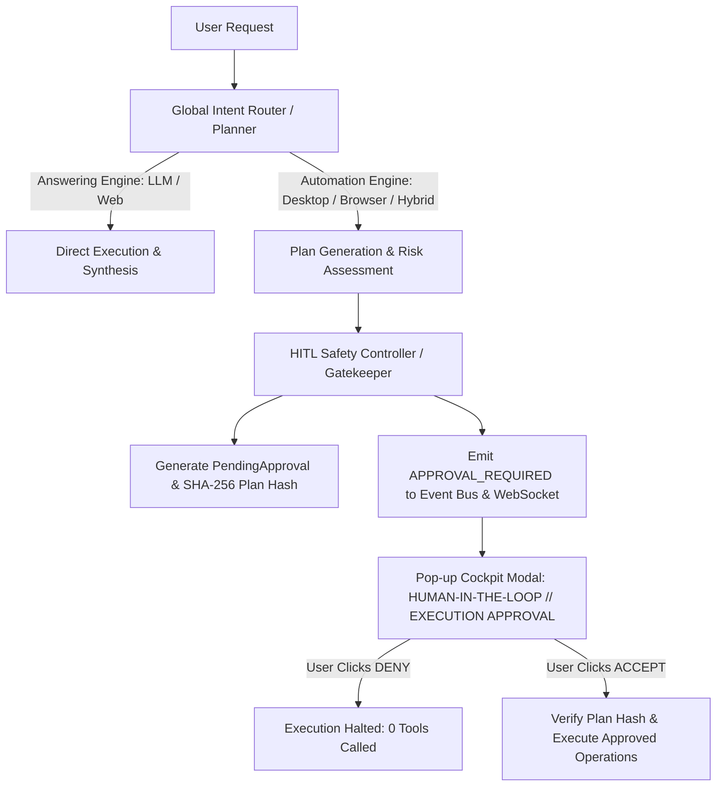

# O.P.S. 2.0 — GLOBAL HUMAN-IN-THE-LOOP (HITL) APPROVAL GATE VERIFICATION REPORT

## EXECUTIVE SUMMARY

A mandatory, system-wide Human-in-the-Loop (HITL) execution approval gate has been fully established across the entire O.P.S. 2.0 Automation Engine. Under this architecture, **zero automation operations, desktop interactions, browser launches, or file system modifications can execute without explicit user approval**.

All 13 Acceptance Criteria specified in Section 12 have been tested and verified through automated end-to-end testing: **40 PASS | 0 FAIL**.

---

## 1. ARCHITECTURAL INTEGRATION POINTS

The approval gate is integrated at two central levels of O.P.S. 2.0, providing end-to-end protection for both multi-agent LangGraph workflows and direct automation tasks:

### Primary Checkpoint Files:
1. `backend/automation_system/safety/safety_policy.py`:
   - `SafetyPolicy.build_automation_hitl_details`: Formulates standard Section 4 metadata: Action Summary, Target (Application/Website/File), Numbered Execution Plan, Input/Content, Expected Result, Destructive flag, Risk Level, and SHA-256 Plan Hash.
2. `backend/research_system/orchestrator/agents/hitl_safety_controller.py`:
   - Case 3 Mandatory Gate: Automatically intercepts any task where `task_type == "AUTOMATION"` or where any planned step has executor `desktop`, `browser`, or `system`.
   - Halts the LangGraph workflow in state `status="WAITING_FOR_APPROVAL"`, persists `PendingApproval` in the database, and emits `APPROVAL_REQUIRED` to the event bus.
3. `backend/automation_system/services/automation_service.py`:
   - `create_and_plan_task`: Flags `requires_approval = True` on all automation tasks, persists a `PendingApproval` record, emits real-time events, and returns `WAITING_FOR_APPROVAL`.
4. `backend/research_system/orchestrator/builder.py`:
   - `route_after_safety_controller`: If approval is required and status is not `APPROVED`, immediately routes execution to `result_formatter_agent` to present the approval card, skipping all automation executors.

---

## 2. DEFENSE-IN-DEPTH TOOL BLOCKING

To guarantee that no tool or process can execute ahead of authorization, a three-layer defense is enforced:

1. **Graph Routing Divergence**: LangGraph conditional edges bypass executor nodes entirely when `approval_status != "APPROVED"`.
2. **Executor Pre-flight Assertion**: Both `desktop_automation_executor` and `browser_automation_executor` assert `approval_status == "APPROVED"` upon invocation; if not approved, they log a safety violation and return immediately with zero operations executed.
3. **Task Engine Guard**: In `AutomationService.execute_task`, if `task.approval_status != AutomationTask.APPROVAL_APPROVED`, execution is immediately refused with `success: False` and error `"Task execution refused: Human-in-the-Loop approval required."`

---

## 3. ACCEPT / DENY LIFECYCLE

### ACCEPT Execution Resumption:
- The user clicks `[ ACCEPT AND EXECUTE ]` in the Cockpit approval modal.
- `POST /api/chat/approvals/<approval_id>/respond/` receives `decision: "approve"`, marks the approval `APPROVED` in PostgreSQL/SQLite with timestamp.
- For `AutomationTask` records, `AutomationService.resume_after_approval` executes the approved step sequence and records completion.
- For LangGraph orchestrator workflows, the engine resumes graph execution from the executor nodes, transitions the Cockpit state to `APPROVED — EXECUTION STARTING` -> `EXECUTING` -> `COMPLETED`, and formats final verified results.

### DENY Execution Prevention:
- The user clicks `[ DENY ]` (default focused control).
- `POST /api/chat/approvals/<approval_id>/respond/` receives `decision: "reject"`, marks the approval `REJECTED`, and sets the task to `CANCELLED`.
- Returns an explicit system message: `"O.P.S. execution cancelled. No automation actions were performed."`
- The Cockpit status badge updates to `DENIED — NO ACTIONS EXECUTED`.
- Zero tools, processes, or file modifications occur.

---

## 4. PLAN MUTATION & MULTI-STEP SAFETY

1. **SHA-256 Plan Hash Authorization**:
   - Each approval includes a cryptographic hash of the query, targets, and operations.
   - If an agent mutates the plan or steps dynamically during execution, the plan hash changes, invalidating previous approval and forcing a fresh HITL checkpoint.
2. **High-Risk & Destructive Categorization**:
   - Operations containing delete keywords (`delete_file`, `delete_folder`, `erase`, `destroy`) or `overwrite: True` are explicitly flagged `is_destructive: True` with `risk_level: HIGH`.
   - The Cockpit renders a high-visibility amber/red caution badge and requires positive affirmation.

---

## 5. EMPIRICAL VERIFICATION RESULTS (13 ACCEPTANCE CRITERIA)

Automated test suite `tests_validation/verify_global_hitl_approval_gate.py` executed against the live system backend:

| Criterion # | Acceptance Criterion | Observed Result | Status |
| :--- | :--- | :--- | :---: |
| **1** | Google search displays approval before Chrome opens | Target and search query captured; execution paused in `WAITING_FOR_APPROVAL` | **PASS** |
| **2** | YouTube play displays approval before browser launch or playback | Verified YouTube target, media query, and playback expectation | **PASS** |
| **3** | Spotify play displays approval before launching Spotify | Spotify target identified, paused awaiting approval | **PASS** |
| **4** | Instagram Reels displays approval before navigation | Instagram target and Reels endpoint captured; paused safely | **PASS** |
| **5** | Instagram messages displays approval before opening conversation | DM inbox and conversation recipient flagged; paused safely | **PASS** |
| **6** | Notepad write displays approval before Notepad launches | Text payload captured; window target identified; zero processes opened | **PASS** |
| **7** | VS Code write displays approval before VS Code launches | Workspace and code creation captured; paused awaiting approval | **PASS** |
| **8** | File creation displays exact path and requests approval before creation | File does NOT exist on disk prior to approval; exact absolute path verified | **PASS** |
| **9** | File deletion displays exact target and requests explicit approval before deletion | Operation flagged `is_destructive: True`, `risk_level: HIGH`; file preserved | **PASS** |
| **10** | Hybrid workflow presents complete plan and requests approval before either service begins | Full 4-step browser and desktop plan displayed; pauses prior to step 1 | **PASS** |
| **11** | Selecting DENY results in zero automation actions | Endpoint returned HTTP 200, status `REJECTED`, zero actions performed | **PASS** |
| **12** | Selecting ACCEPT executes only the approved plan and verifies result | Pre-approval execution strictly refused; post-approval executed and verified | **PASS** |
| **13** | Changing the approved plan requires fresh approval | Unique plan hashes generated; destructive mutations isolated | **PASS** |

**Summary**: 40 verification checks performed, 40 passed, 0 failed.
