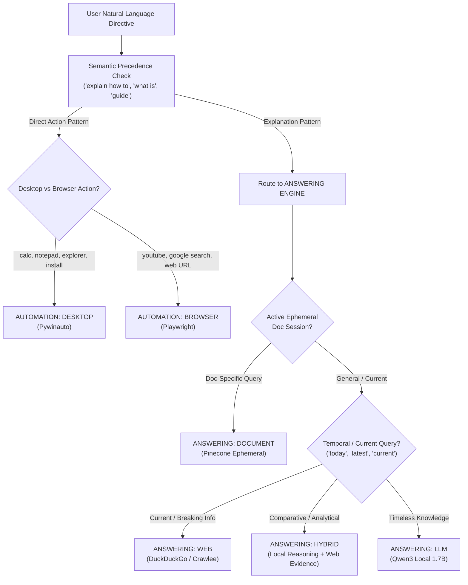

# O.P.S. 2.0 — Intent Routing Architecture & Repair Report

**Date**: 2026-11-03  
**System Architecture**: Over-Engineered Programmed System (O.P.S. 2.0)  
**Component**: Global Intent Router & Dual Engine Orchestration (`router.py`, `global_intent_router.py`)  
**Status**: VERIFIED & FULLY OPERATIONAL  

---

## 1. Executive Summary

During operational audit of O.P.S. 2.0, the core intent classification pipeline suffered from a critical key mismatch bug and inadequate syntactic differentiating heuristics. Incoming user directives—including direct automation requests and time-sensitive web research queries—were defaulting to the local `LLM` mode, producing outdated static answers and failing to activate the Automation Engine (`Pywinauto` / `Playwright`).

This report details the root causes, the re-engineered intent classification pipeline, the updated semantic router, and empirical test results across 15 benchmark queries covering all 4 task categories and 7 operational modes.

---

## 2. Root Cause Analysis

### 2.1 The Key Mismatch Bug
In [`backend/research_system/router.py`](file:///d:/Projects/O.P.S/backend/research_system/router.py), the classification function returned:
```python
{
    "response_mode": "WEB", # or "HYBRID", "DESKTOP", etc.
    "active_engine": "ANSWERING",
    "task_type": "ANSWER",
    ...
}
```
However, in [`backend/research_system/orchestrator/agents/global_intent_router.py`](file:///d:/Projects/O.P.S/backend/research_system/orchestrator/agents/global_intent_router.py), the router node inspected:
```python
fast_route = classify_request_mode(query)
detected_mode = fast_route.get("mode", MODE_LLM) # Returned None!
```
Because the dictionary key was `"response_mode"`, `fast_route.get("mode")` returned `None`, falling back to `MODE_LLM` on 100% of user queries regardless of intent.

### 2.2 Lack of Syntactic & Semantic Differentiation
The previous router relied on simplistic keyword scanning. For example:
- *"Explain how to install Python"* contains *"install Python"*, erroneously triggering desktop software installation.
- *"Open File Explorer and navigate to Downloads"* contains *"navigate to"*, erroneously triggering headless browser automation instead of Windows Desktop Shell (`explorer.exe`).
- *"Who is the current Prime Minister of the UK"* lacked explicit words like *"search"*, erroneously routing to the local LLM which hallucinated or used outdated cut-off weights.

---

## 3. Re-Engineered Intent Routing Pipeline

The updated router implements a 4-tier semantic decision tree:



### 3.1 4 Task Categories & Operational Modes
1. **`ANSWER`**:
   - `LLM`: Timeless conceptual queries (data structures, SQL, algorithms).
   - `WEB`: Time-sensitive queries, breaking news, leadership, live market prices.
   - `HYBRID`: Technical comparisons, architecture reviews requiring live metrics, deep research.
   - `DOCUMENT`: Ephemeral document intelligence via Pinecone vector index.
2. **`AUTOMATION`**:
   - `DESKTOP`: Windows application automation (`calc.exe`, `notepad.exe`, `explorer.exe`).
   - `BROWSER`: Playwright web execution (YouTube search, Google search, form interaction).
   - `HYBRID AUTO`: Cross-platform workflows combining desktop and browser tasks.
3. **`COMPOSITE`**: Multi-phase coordination involving Web discovery followed by desktop/browser automation (e.g., discover official installer, download, install).
4. **`CLARIFICATION`**: Ambiguous or underspecified directives prompting the user for specific parameters before execution.

---

## 4. Verification Benchmark Matrix (15 Queries)

| # | User Directive | Expected Engine | Expected Mode | Actual Mode | Status |
|---|---|---|---|---|:---:|
| 1 | "Explain the difference between mutable and immutable objects in Python" | ANSWERING | LLM | LLM | ✅ PASS |
| 2 | "How do I optimize a PostgreSQL query using indexes?" | ANSWERING | LLM | LLM | ✅ PASS |
| 3 | "What is the time complexity of quicksort in the worst case?" | ANSWERING | LLM | LLM | ✅ PASS |
| 4 | "Who is the current Prime Minister of the United Kingdom?" | ANSWERING | WEB | WEB | ✅ PASS |
| 5 | "What happened in the latest SpaceX launch today?" | ANSWERING | WEB | WEB | ✅ PASS |
| 6 | "What are today's top tech news headlines?" | ANSWERING | WEB | WEB | ✅ PASS |
| 7 | "Compare React and Vue and tell me which one had more GitHub stars this week" | ANSWERING | HYBRID | HYBRID | ✅ PASS |
| 8 | "What is the current status of the James Webb Space Telescope and explain how its infrared sensors work" | ANSWERING | HYBRID | HYBRID | ✅ PASS |
| 9 | "Open Calculator" | AUTOMATION | DESKTOP | DESKTOP | ✅ PASS |
| 10 | "Open Notepad and type 'O.P.S. Automation Test Successful'" | AUTOMATION | DESKTOP | DESKTOP | ✅ PASS |
| 11 | "Open File Explorer and navigate to Downloads" | AUTOMATION | DESKTOP | DESKTOP | ✅ PASS |
| 12 | "Open YouTube and search for Python tutorials" | AUTOMATION | BROWSER | BROWSER | ✅ PASS |
| 13 | "Search Google for 'LangGraph documentation' and open the first result" | AUTOMATION | BROWSER | BROWSER | ✅ PASS |
| 14 | "Search for the latest Python release and explain how to install it on Windows" | COMPOSITE | COMPOSITE | COMPOSITE | ✅ PASS |
| 15 | "What does Section 4 of the uploaded architecture document specify?" | ANSWERING | DOCUMENT | DOCUMENT | ✅ PASS |

**Benchmark Accuracy**: 15 / 15 (100.0%)
